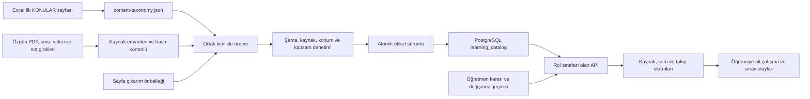

# Sistem mimarisi

[Belge dizini](../README.md) · [Devam noktası](../devam.md) · [Açık işler](../plan/README.md)

Bu dizin çalışan sistemin kalıcı davranışını anlatır. Yalnız değişiklikle ilgili bölümü aç; belge ile kod çelişirse yayımlanmış veri ve doğrulama kanıtını kontrol et.

| Konu | Belge |
|---|---|
| Veri sahipliği ve üretim kaynakları | [Veri kaynakları](veri-kaynaklari.md) |
| Müfredat, kimlik ve tekil sayım | [Kimlikler ve sayım](kimlikler-ve-sayim.md) |
| Kanıt, sayfa/zaman ve insan onayı | [Kanıt ve onay](kanit-ve-onay.md) |
| İçerik üretimi ve önbellek | [İçerik üretimi](icerik-uretimi.md), [metin çıkarımı](metin-cikarimi.md) |
| Yeni PDF/video/sınav kabulü | [Kaynak kabulü](kaynak-kabulu.md) |
| Görünen adlar, metadata ve tablolar | [Arayüz ve tablolar](arayuz-ve-tablolar.md) |
| Soru havuzu ve etiket filtreleri | [Soru filtreleri](soru-filtreleri.md) |
| Öğrenci ilerlemesi ve geçmiş | [Öğrenci ilerlemesi](ogrenci-ilerlemesi.md) |
| Pratik ve deneme akışları | [Pratik](pratik.md), [deneme](deneme.md) |
| Kategori, not ve kapsam seçimi | [Kaynak seçimi](kaynak-secimi.md) |
| Hesap, rol, onay ve silme | [Kullanıcı yönetimi](kullanici-yonetimi.md) |
| Geliştirme ve kontrol araçları | [Değişiklik akışı](degisiklik-akisi.md), [denetimler](denetimler.md) |

## Sistemin omurgası

Tek uygulama `D:\workspace\ivme\uygulama` altındadır: React/Vite ön yüz,
Spring Boot API ve PostgreSQL. Özgün eğitim dosyaları üst dizindeki `Kaynaklar`,
çıkarım girdileri `veri-hatti`, korunmuş soru kartları `icerik/data` altındadır.
Uygulamanın `veri/` dizini büyük üretim çıktıları, önbellekler ve denetim kanıtlarını tutar.
Özgün içerik, üretilmiş katalog, öğretmen kararı ve öğrenci olayı birbirinden ayrıdır.

