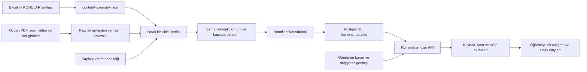

# İvme — kalıcı sistem ve değişiklik rehberi

Bu belge sistemin nasıl kurulduğunu ve ileride nasıl değiştirileceğini anlatır.
Yapılacaklar listesi, tamamlanan adımların özeti veya oturum günlüğü değildir.
Güncel görev [çalışma bağlamında](00_CALISMA_BAGLAMI.md), iş sırası
[yol haritasında](00_YOL_HARITASI.md) bulunur. Uygulama değiştiğinde ilgili
sözleşme ve bu rehber aynı işte güncellenir. Kaynak kodla çelişirse önce gerçek
kod, veri sürümü ve doğrulama kanıtı kontrol edilir; belge tek başına tamamlanma kanıtı değildir.

## Sistemin omurgası

Tek uygulama `D:\workspace\ivme\uygulama` altındadır: React/Vite ön yüz,
Spring Boot API ve PostgreSQL. Özgün eğitim dosyaları üst dizindeki `Kaynaklar`,
çıkarım girdileri `veri-hatti`, korunmuş soru kartları `icerik/data` altındadır.
Uygulamanın `veri/` dizini büyük üretim çıktıları, önbellekler ve denetim kanıtlarını tutar.
Özgün içerik, üretilmiş katalog, öğretmen kararı ve öğrenci olayı birbirinden ayrıdır.

## Hangi bilginin tek kaynağı var?

| Bilgi | Bakım/üretim kaynağı | Tüketim ve sınır |
|---|---|---|
| Ders, ünite, konu ve soru dağılımı | `Kaynaklar/mufredat/YKS_TYT_AYT_Konu_Soru_Dagilimi_2018-2026.xlsx` dosyasının yalnız ilk `KONULAR` sayfası → üretilmiş `content-taxonomy.json` | Çalışma anında tek kayıt `learning_catalog.current_categories.definition`; diğer sayfalar ve eski müfredat listeleri seçilebilir başlık üretmez |
| Seçilebilir konular ve ünite grupları | Aynı DB kategori kaydında `canonicalUnit=true`, `unitId`, `unit`, `excelRowId` | 453 kaynak satırı, 12 özgün ders grubu → 14 ayrı ders, 146 ünite; kapsam işaretlerine göre 178 TYT / 352 AYT kimliği. `canonicalUnit` eski API alanıdır ve seçilebilir konu satırını belirtir |
| Zorluk, beceri, içerik türü, ilişki ve inceleme değerleri | `backend/src/main/resources/review-vocabulary.json` | Konu kimliğinden ayrı boyutlardır |
| Etkin yayımlanmış etiket sürümü | PostgreSQL `learning_catalog.current_run` | Aynı sürümün `current_items`, `current_categories`, `current_assignments` görünümleri |
| Yerel üretim adayı | `veri/content-labels/labels.json` ve `report.json` | Üretilmiş çıktı; elle düzeltilmez, yayımlanmış sürümle aynı olduğu varsayılmaz |
| Öğretmen kararı | `content_reviews` ve `content_review_history` | Kaynak/görsel/kategori değişimi onayı eskitebilir; otomatik etiket yayını kararı değiştirmez |
| Soru, cevap ve öğrenci geçmişi | İlgili soru/çalışma/sınav tabloları | Etiket üretimi bu verileri değiştirmez; ilk deneme ve anlık kayıt korunur |
| Görev ve devam noktası | Bu dizindeki açık numaralı adımlar ve `00_CALISMA_BAGLAMI.md` | Başka bir eksikler veya yapılanlar listesi açılmaz |

`content-review-catalog.json`, `pdf-review-labels.json`, `content-label-categories.json`
ve ön yüz kimlik dosyası projeksiyondur. İlgili üreticileri çalıştırmadan bu dosyaları
elle düzeltmek sonraki build'de değişikliği kaybettirir veya sürüm farkı yaratır.
Branş CSV'leri ve eski kaynak başlıkları kanıt girdisidir; ikinci bir kontrollü sözlük değildir.

Çalışma anında kategori kimliği, tercih edilen ad ve ortak kaynak etiketi için
tek doğruluk kaynağı PostgreSQL'dir. `ReviewCatalog.categories()` yalnız
`current_categories` tanımlarını ve DB'deki mevcut `taxonomy_nodes` boyutlarını
sunar; paketlenmiş JSON bunları ezmez, soru başlığından yeni kategori üretmez.
`taxonomy:<nodeId>` eski soru tipi/beceri boyutunun korunmuş DB kimliğidir;
aynı konu için yeni dosya sözlüğü değildir. Henüz yayımlanmamış kategori bir
öğretmen kararında veya takip bağında seçilemez. Yeni kurulumda önce ortak
katalog yayınlanır; eksik DB kaydı dosyadan tamamlanmış gibi gösterilmez.

Öğretmen ekranındaki PDF dahil otomatik etiketler de aynı `current_items`
kaynağından gelir. Paketlenmiş kaynak içeriği/orijinal künye kanıt olarak
gösterilebilir; DB etiketi yoksa otomatik onay veya etiket üretilmez. Öğretmen
dışa aktarımı aynı güncel etiketleri kullanır. Ayrı test DB'sindeki paket
örnekleri test altyapısı tarafından açıkça eklenir; uygulama servisi eklemez.

Ortak kaynak ve öğretmen okuma işlemleri `REPEATABLE_READ` anlık kaydı kullanır;
eşzamanlı atomik yayın bir yanıtta eski özetle yeni kategori/ilişkiyi karıştırmaz.
Bu tercih [PostgreSQL işlem yalıtımı](https://www.postgresql.org/docs/current/transaction-iso.html)
ve [Spring işlem sınırı](https://docs.spring.io/spring-framework/reference/data-access/transaction/declarative/annotations.html)
kurallarına dayanır. Özel ders kaynağı `current_assignments` ile doğrulanır;
yalnız geçmiş sürümde bulunan ilişki yeni bir bağ için kabul edilmez.
Müfredatın yerleşimi yereldir; görünen konu/alt konu adı API metadata'sından
alınır. Ad değişse de kayıtlı kategori, ilerleme ve video kimliği korunur.

Soru çıkarımında fiziksel sayfa, basılı soru numaraları, özgün görsel/kırpım
referansı ve ham kayıt yolu korunur. Bir kitap adı ile sayfa numarası, katalogda
doğrulanmış PDF dosyası yoksa PDF bağlantısı üretmez. Soru kökü ve seçenekler
ölçülen görevi belirler; parçada “sanat/ahlak” geçmesi tek başına felsefe etiketi
verdirmez. `content-source-analysis.py` önerileri metin/görsel hash'ine bağlıdır;
karma karttaki her kanıt yalnız desteklediği kategoriye bağlanır. Önceki model
etiketi, bağımsız içerik doğrulaması yapılana kadar düşük güvenlidir.

PDF banka eşleşmesi ile tam işlenme ayrı durumlardır. `pdf-bank-audit.json.gz`
özgün yol, SHA-256 ve canlı soru kodunu kanıtlar; eşleşen sorular PDF'deki bütün
soruların alındığını tek başına kanıtlamaz. Main'deki `veri/pdf-arsiv` ayrı bir
mantıksal arşivdir; paylaşılan `Kaynaklar` dosyaları feature ortamı için korunur.
Arşiv kaydı ancak tüm soru kodları ve kalan uygulama referansları doğrulanınca
`scripts/pdf-archive.py` üzerinden `learning_catalog.pdf_archive` içine yazılır.
Bu işlem paylaşılan özgün PDF'yi silmez; main'in normal PDF listesi ve dosya API'si
arşiv hash'ini gizler. Yeni PDF'ler `scripts/pdf-source-copy.py`
ile main'e ait `veri/pdf-gelen` klasörüne alınır; kopyalama öncesi kaynak,
arşiv ve gelen klasörlerindeki SHA-256 kimlikleri kontrol edilir. Aynı içerik
tekrar kopyalanmaz. Arşiv inceleme kuyruğu tek başına arşiv kaydı veya dosya
taşıma işlemi değildir.

`question-label-check.py` CSV–statik JSON projeksiyonunu, güncel ortak soru
kimliklerini, eski araştırmanın metin/görsel sürümünü ve not örneklerini salt
okunur karşılaştırır. Rapor `question-checks/<runKey>/` altında tutulur. Kimlik
ve sürüm tutarlılığının geçmesi anlamsal doğruluk onayı değildir; değişmiş kanıt
nedenleri `content-label-audit.py` ile aynı kalite kuyruğuna eklenir.

Notun destek PDF sayfası `SUPPORTING_LESSON_PAGE`, asıl örnek sorusu
`ORIGINAL_EXAMPLE_QUESTION`, not bölümü ise `NOTE` konumudur. Bunlar birbirinin
yerine kullanılamaz. Örnek soru tek `question:<code>` kaydına bağlanır; cevap ve
çözüm açıklaması genel kaynak metadatasına kopyalanmaz. Not ve mini soru URL'si
`konu=<lessonId>`, kalıp gerekiyorsa `kalip=<patternId>` ve bölüm çapasını taşır.
Destek sayfası bütün notun veya her konu ilişkisinin onayı sayılmaz.

`question-source-repair-preview.py` kırpım onarımını özgün PDF'nin doğrulanmış
sayfa/koordinatlarından ayrı aday PDF/PNG olarak hazırlar. İki sütuna yayılan soru
parçaları okuma sırasıyla yerleştirilir; metin/formül yeniden üretilmez. Manifest
eski görsel ve kaynak PDF hash'ini, parçaları ve aday hash'ini saklar. Aday
hazırlamak soru bankasındaki görseli, cevabı veya geçmişi değiştirmez; asıl veri
düzeltmesi eski dosyayı/sürümü koruyan ayrı işlemdir.

## Kimlikler ve sayım

Müfredatın tek içerik referansı `Kaynaklar/mufredat/YKS_TYT_AYT_Konu_Soru_Dagilimi_2018-2026.xlsx`
dosyasının ilk `KONULAR` sayfasıdır. Diğer Excel sayfaları okunmaz. İçe aktarıcı,
4. satırdaki başlıkları doğrular ve 5–457 arasındaki 453 satırın ders, sınıf,
ünite, konu, kapsam işaretleri, toplamlar, notlar ve 2018–2026 sayılarını aynen alır.
`✓*`, boş hücre ve 0 birbirinden ayrıdır; toplu başlıklar için sayı dağıtılmaz.
Kullanıcının talimatıyla Matematik + Geometri ve Türkçe / Edebiyat grupları,
yalnız bu sayfadaki ünite ve konulara göre Matematik, Geometri, Türkçe ve
Edebiyat olarak ayrılır. Üçgenler/dörtgenler/çokgenler/analitik/uzay geometrisi
Geometri; fonksiyonlar/trigonometri/türev/integral Matematik kapsamındadır.
Anlam ve dil bilgisi Türkçe; edebiyat bilgisi, dönemleri ve akımları Edebiyat
kapsamındadır. Aynı kaynak satırı iki sınavda yer alsa da tek derse aittir.
Özgün birleşik ad `sourceSubject` ve `distribution.subject` içinde korunur;
ekranlar ayrılmış `subjectId`/`subject` alanlarını kullanır. Yeni konu veya
ikinci çalışma zamanı sözlüğü üretilmez.

Çalışma anında bütün ekranların tek ders/ünite/konu tablosu PostgreSQL
`learning_catalog.current_categories` görünümüdür. `definition` içindeki `unitId`,
`unit`, `topic`, `subjectId`, `subject`, `gradeLabel` ve `distribution` alanları
aynı kayıttan sunulur. Ayrı dağılım tablosu veya ön yüzde elle yazılmış ders listesi
yoktur. `curriculumReference.js` yalnız bu DB metadata'sının sunum projeksiyonudur.
Tabloların `.xlsx` indirmesi ortak `DataGrid.jsx` içindedir: o anda yüklenmiş,
filtrelenmiş ve sıralanmış satırların tamamını sayfalama sınırı olmadan alır;
sunucudan henüz getirilmemiş başka sayfaları kendiliğinden sorgulamaz.
Dersler'deki Konu takibi ve Konu ve soru dağılımı sekmeleri, Soru Çöz/pratik
ve soru bankası aynı kimlikleri kullanır. Dağılım tablosu iki sınavda
olan satırları `excelRowId` ile bir kez gösterir. İlerleme sınav başına kimlikle
hesaplanır; tekil soru genel toplamda çoğalmaz. Bir ünite iki sınavda 26 konu
kimliğine sahip olabildiğinden ortak seçim sınırı 100'dür; ünite seçimi kesilmez.

`scripts/excel-curriculum-import.py` yalnız ilk sayfayı okur; aynı adlı `.mjs`
içe aktarıcı mevcut kontrollü sözlüğü günceller. İlk kimlikler ders/ünite/konu
bileşiminden deterministik üretilir; sonraki içe aktarımlarda mevcut satır ve ad
eşleşmeleri korunur. Satır kayması veya izlenebilen başlık düzeltmesi kimliği
değiştirmez; kaldırılan sınav/konu kimlikleri seçilemeyen tarihsel kayıt olarak kalır.
`unitReference.sha256` yalnız ilk sayfadaki veri satırlarının hash'idir. Eski
kimlikler `selectable=false` ve `canonicalTopicIds` yönlendirmeleriyle korunur.
`SOURCE_CURRICULUM`, eski PDF/video çıkarımı için tutulur; seçilebilir sözlük
veya kullanıcıya gösterilen ders/konu referansı olamaz.

Mevcut bir yayını kayıpsız taşımak için sırasıyla `excel-curriculum-snapshot.py`,
`excel-curriculum-import.py`, `node --max-old-space-size=6144 scripts/excel-curriculum-relabel.mjs`,
`learning-resource-check.mjs`, `excel-curriculum-audit.py` ve
`content-label-publish.py --database ivme` kullanılır. Snapshot, mevcut DB
kataloğunu aynı okuma işlemi içinde alır. Denetim kaynak kimliklerini ve kaynak
sürümlerini mevcut DB ile birebir karşılaştırır; eski çıkarım denetimi ayrıca
saklanır ve yeniden yapılmış gibi gösterilmez. Yayın önceki katalog hâlâ
etkinse tek işlemde geçer. Önceki sürüm ve öğrenci geçmişi korunur.
Yalnız ders adı/kapsamı ayrılırken `excel-curriculum-relabel.mjs --refresh-definitions`
kullanılır: konu ve ünite kimlikleri, içerik, kaynak ve soru–konu bağları korunur;
yeni ders adları ve ilişki tanım sürümleri güncellenir. Denetim bu kipte
eski/yeni kaynak başına kategori kimliği listesini de birebir karşılaştırır.

Soru/PDF/video ilişkileri yalnız Excel'in aynı sınav ve ders kapsamındaki
konularına eşlenir. Kaynak başlığından türetilen ilişkiler `CANDIDATE/LOW`
olarak görünür; geniş kaynak birden fazla aday konuya bağlanabilir. Dar konu
kanıtı olmayan kayıt, ilgili dersin seçilemeyen `system.*.konu-incelemesi`
etiketiyle korunur; öğrenciye görünen sorular bu durumda kalmaz (aşağıdaki tamamlama).
Öğretmen onayı, konuya özel PDF/video konumu veya dar konu
başarısı uydurulmaz. Sorunun kendi kaynak alt konusu (OGM kartında kazanım,
elle veya kitap başlığı kaynaklı; model tahmini değil), elle düzeltilmiş alt
konusu ya da test başlığı tek bir Excel konusunun adıyla aynıysa (sözcük sırası
serbest) `excel-curriculum-relabel.mjs` soruyu yalnız o konuya bağlar
(`confidence=HIGH`, yine `CANDIDATE`). Çok konulu ünitenin kendi adı veya başka
bir Excel konusunu gösteren kaynak/arşiv kanıtı bu daraltmayı engeller; adım
idempotenttir ve her turun listesi `veri/content-labels/source-subtopic-matches-from-<önceki run>.json`
dosyasına yazılır. Dar ad bulunmayan ünite geneli sorular ünitenin bütün
konularında sayılır. `questions.topic`, cevaplar ve olay anındaki etiket
anlık kayıtları değiştirilmez.

Soru–konu tamamlama: öğrenciye görünen her soru (OGM + çıkmış) en az bir Excel
konusuna bağlı olmalıdır; yoksa konu/ders süzgeçlerinde çıkmaz. Konusuz kalan
sorular için `scripts/question-topic-completion.py` (DB'yi ve
`veri/content-labels/source-inventory.json`'ı okur) her soruya tek bir Excel konusu
önerir ve `veri/content-labels/question-topic-decisions.json` dosyasına yazar.
Yöntemler: `EXACT_NAME`/`NAMED_UNIT` (kaynak başlığı konu/ünite adı), `TEXT_MODEL`
(ders grubu başına TF-IDF + kazanım özellikli doğrusal sınıflayıcı), `DUPLICATE`,
`PRIOR` (kaynak kazanım/alt başlığına göre en yakın konu) ve `CONTENT_READ`
(`veri/content-labels/question-topic-reviewed.json`: soru metni veya görseli
okunarak elle verilen karar; aynı metinli kopyalara `CONTENT_READ_COPY` yayılır).
`veri/content-labels/question-topic-applied.json` içindeki sorular önceki turda tamamlanmış
sayılır: planlayıcı bunları yeniden planlar ve eğitimde etiket olarak kullanmaz, böylece
okuma düzeltmeleri aynı hat üzerinden yeniden uygulanır.
Bütün model (`TEXT_MODEL`) kararları da okunarak doğrulandı; kaynakta karşılığı olmayan konular
(ör. “Orta Çağ'da Dünya”, “Su, Hayat ve Çevre Kimyası”) en yakın Excel konusuna
konup öğretmen onayı bekler. `excel-curriculum-relabel.mjs` kararı, yalnız hâlâ Excel
konusu olmayan sorulara `PRIMARY/CANDIDATE` ilişki (`review.status=PENDING`,
`confidenceReason` “öğretmen onayı gerekiyor”, `reviewReasons=TOPIC_APPROVAL_REQUIRED`,
kanıt türü `QUESTION_TOPIC_COMPLETION`) olarak ekler, `system.*` yer tutucusunu ve
`unitReview`'i kaldırır; mevcut Excel konusu olan sorulara dokunmaz. Sorunun `examIds`
alanı her zaman kaynak sınavını da içerir: TYT kaynaklı bir soru yalnız AYT'de bulunan bir
konuya bağlıysa hem TYT hem AYT süzgecinde çıkar. Bu bağlar öğretmen onayı değildir.

Güncel istatistikler yeni ortak kimlikleri,
tarihsel sınıflama kayıt anındaki etiketleri kullanır.

Eski tek hedefli tamamlanma, yeni kimlikle gösterilebilir; birden çok konuya
ayrılan eski tamamlanma bütün alt konuları bitmiş saymaz. Geri alma tek hedefli
eski bağları da aynı işlemde kaldırır. Ayrı bir öğrencinin kaydı etkilenmez.

- `categoryId` kavramı, `itemKey` katalog kaydını, `canonicalAssetId`/envanterdeki
  `entityKey` aynı fiziksel/sağlayıcı varlığını, `relationKey` kaynak–kategori ilişkisini tanımlar.
- Bir PDF'nin aynı hash'e sahip iki katalog kaydı korunabilir. Bu iki kimlik,
  fiziksel kaynak sayısı ve konu referansı sayısının aynı olduğu anlamına gelmez.
  Farklı baskılar veya benzer soru görselleri başlıktan birleştirilmez.
- Video sağlayıcı kimliği konuya göre değişmez. Playlist, video ve başlangıç
  zamanı ayrı bilgilerdir. Eski konuya gömülü bağlantılar taşınırken yönlendirme korunur.
- Başlık düzeltmesinde `id` değişmez; eski terim `aliases` içine alınır ve kimlik
  projeksiyonu yeniden üretilir. Kimlik birleştirmesi açık yönlendirme ve
  öğretmen/ilerleme taşıma değerlendirmesi gerektirir.
- `PRIMARY` doğrudan konu, `SECONDARY` eşlik eden konu, `PREREQUISITE` ön bilgidir.
  Birden fazla ana ilişki olabilir. Üst/alt konu genişlemesi aynı kaynak veya öğrenci
  olayını iki kez saydırmaz. Genel toplam tekil soru/olay kimliğine dayanır.

## Kanıt, konum, güven ve onay

`Dersler > PDF envanteri` denetimi `scripts/pdf-bank-audit.py` ile üretilir.
PDF kimliği mevcut katalogdan, soru kökeni `veri/content-labels/source-inventory.json`
kaydından, bankada bulunma ve kaynak damgası ana `questions` tablosundan gelir.
Soru bağı gösterilen PDF'lerin fiziksel SHA-256'sı doğrulanır.
`pdf-bank-audit.json.gz` ilk aktarım ve geri izleme için sürümlü bir anlık kayıttır.
Çalışan uygulama 2.708 denetim satırını `learning_catalog.pdf_audit_rows`, denetim
zamanı ve banka damgasını `learning_catalog.pdf_audit_state` içinden okur. İlk aktarım
`scripts/pdf-bank-audit-publish.py` ile mevcut anlık kayıttan yapılır; PDF'ler yeniden
okunmaz. Satır güncellemesi aynı katalog kimliğinde DB kaydını değiştirir.
Yeni soru veya PDF yayını sonrasında kapsam denetimi gerektiğinde üretici yeniden
çalıştırılıp kayıtlar ayrıca yayımlanır. Bu bağ aynı PDF'deki bütün soruların
çıkarıldığını kanıtlamaz. Çevrim içi OGM Soru Bankası kartlarının belirli okul
PDF'siyle bağı yoksa PDF otomatik olarak eksik veya tamamlanmış sayılmaz.
V75 `learning_catalog.pdf_work_queue` kullanıcının soru çıkarma veya silme
incelemesi seçimini PDF katalog kimliği ve kaynak hash'iyle tutar. Seçim bankaya
soru eklemez, kaynak PDF'yi silmez, yayımlanmış kaynak sürümünü değiştirmez.
Silme/çıkarım ancak ilgili kaynak ve cevap doğrulamasından sonra ayrı kabul
işlemidir.
Mini Deneme Test 04'ün numara konumu diğer testlerden kaydığı için
`scripts/pdf-question-candidates.py` yalnız bu kaynak hash'ini kabul eder,
ortak veri hattı koduna dokunmadan 60 aday WebP/metin/iki cevap okumasını
`veri/content-labels/pdf-extraction/mini-test-04` içinde hazırlar. Bu paket
`CANDIDATE_NOT_IN_BANK` durumundadır; öğrenci kaydı, soru kodu ve mevcut
katalog yayınını değiştirmez. Aday API'si paket/görsel hash'ini okurken
yeniden denetler.

[Ortak kaynak v2 şeması](sema/learning-resource-v2.schema.json) ve
[temsili örnekler](sema/learning-resource-v2.ornek.json) veri sözleşmesidir.
Üretim ve yayın kabulü `scripts/learning-resource-contract.mjs` ve
`scripts/learning-resource-check.mjs` ile denetlenir. V38'in ilişki indeksi
korunur; ayrıntılar mevcut `items.data` JSON'undaki ilişkilerdedir.
V42 `current_relation_details` görünümü bunları SQL'e açar.

Bir ilişkide `sourceVersion`, `categoryFingerprint`, aday/kesin kapsam,
gerekçeli `LOW/MEDIUM/HIGH`, kanıt, konum durumu ve ayrı inceleme vardır.
`ITEM_ONLY` eski kaynak düzeyi kanıtıdır; konuya özel `RELATION` kanıtı veya
tam içerik okuması sayılmaz. `NOT_MEASURED` OCR okunabilirliği ölçülmediğini belirtir.
Yüksek güven de öğretmen onayı değildir. Otomatik çıktı öğretmen adı veya onayı üretmez.

PDF fiziksel sayfaları 1 tabanlıdır ve iki uç dahildir. Video başlangıcı dahil,
bitişi hariç saniye aralığı kullanır; süre aşılmaz. Kesintili bölümler ayrı aralıktır.
Konum `MISSING`, `NOT_APPLICABLE`, `ESTIMATED` veya `VERIFIED` olur ve neden taşır.
Sabit soru kodunun veya not bölümünün doğrulanması destek PDF'sinin doğrulandığı
anlamına gelmez. Notun destek sayfaları, notun kendi bölümü ve asıl örnek sorunun
kaynağı ayrı tutulur. İçindekiler sayfası anlatım sayfası sayılmaz; bir başlık
sayfası bulunması bütün PDF'nin konu aralığının tamamlandığı anlamına gelmez.

`system.kapsam-incelemesi` başarı hesabına girmez. Ders biliniyor, dar konu
bilinmiyorsa genel kapsam düşük güven ve nedenle korunur. Sayfa/dakika veya
kanıtsız zorluk uydurulmaz; zorluk `BELIRLENMEDI` kalabilir.

## Üretim ve yeniden başlama

`scripts/content-label-refresh.py` kaynak envanteri, sözlük projeksiyonu,
PDF çıkarımı, etiket üretimi, denetim ve isteğe bağlı yayını sırayla çalıştırır.

| Seçenek | Gerçek davranış |
|---|---|
| `--dry-run` | Komut planını yazdırır; üretim, OCR veya DB yayını yapmaz |
| `--check` | Mevcut yerel çıktıların güncel girdilerle tutarlılığını kontrol eder; yeniden OCR/üretim/yayın yapmaz; denetim raporu yazabilir |
| `--resume` | Girdi imzası ve çıktı hash'i aynı olan tamamlanmış aşamaları yeniden kullanır; DB envanteri ve son denetimler tekrar kontrol edilir |
| `--limit N` | Yeni PDF metin çıkarımını fiziksel kaynak sayısıyla sınırlar; diğer kaynakları envanterden düşürmez; yayınla birleşmez |
| `--ocr-pages N` | İlk sayfa taramasından sonra en fazla N yeni sayfada yerel OCR yapar ve başlıkları yeniden eşler; `--check` veya `--publish` ile birleşmez |
| `--publish` | Bütün üretim/denetimlerden sonra etiket sürümünü atomik yayımlar; uygulama dağıtımı veya Git push değildir |
| `--database` | Yayın hedefini seçer: `ivme` veya `ivme_test`; üretim girdisinin hangi kaynaklardan toplandığını değiştirmez |

`veri/content-labels/workflow.json` devam kaydıdır. Bir aşama başarısızsa sonraki
aşamalara geçilmez. `--resume` çıktısı dışarıdan değiştirilmiş veya girdisi değişmiş
aşamayı geçerli saymaz. Etiket hatası önceki yayımlanmış sürümü silmez.

`content-label-preview.py` aday sürümü yayımlanmış kayıtlarla salt okunur
karşılaştırır; eklenen/silinen/değişen kimlikleri ve değişen alanların sayılarını
`previews/` altına yazar. Kaynak ve ilişki sürümü değişebilir; soru/cevap veya
öğrenci geçmişi yazılmaz. Önizleme kendi başına yayın veya içerik doğruluk onayı
değildir. Gerçek öğretmen kararlarının yeniden kullanılabilirliğini API'nin
kaynak ve kategori anlık kaydı denetimi belirler.

PDF sayfa çıkarımı `scripts/pdf-topic-locations.py` ile yapılır.
`pdf-page-cache/<hash>-<extractorVersion>.json` kaynak çıkarımını saklar;
sözlük/alias değişimi PDF'yi tekrar OCR yapmak yerine mevcut sayfaları yeniden eşler.
Başlık sayfaları `HEADING_ANCHORS_ONLY` ve tahmini konum olarak sunulur.
`pagesNeedingOcr` işlenmemiş sayfaları görünür tutar. Önbellek varlığı tam içerik
incelemesi değildir. Çıkarım yöntemi değişirse çıkarım sürümü değiştirilir.

`pdf-page-ocr.py --limit N --workers 2` yalnız yetersiz metin katmanlı sayfalarda
yerel Türkçe OCR çalıştırır; `--check` önbelleği inceler. Limit verilmezse kalan
sayfalar işlenir. Başarılı her sayfa hemen kaydedilir; kesintiden sonra yeniden
çalıştırma bunları atlar. `pdf_ocr_cache.py` anahtarı PDF hash'i + fiziksel sayfa +
çıkarıcı sürümü + OCR model hash'idir; sözlük değişikliği yeniden OCR gerektirmez.
`pdf-topic-locations.py` bu metni tekrar eşler; OCR başlığını yalnız tahmini
sayfa dayanağı sayar. İşlenmemiş sayfa ile OCR sonrası okunamayan/boş sayfa ayrı
sayılır. OCR formülün, şeklin veya tam konu aralığının doğrulanması değildir.

Video envanteri `scripts/video-source-inventory.py` ile hem müfredattaki hem OGM
kataloğundaki referanslardan üretilir. `video-cache/` sağlayıcı kimliğine göre
genel erişim metadatasını saklar. Aynı video için konu bazında ikinci ağ isteği
gerekmez. Oynatma listesi tek video gibi değerlendirilmez ve tek süre verilmez.
Sağlayıcıdan gelen HTTP 429 silinmiş video değildir; `RATE_LIMITED` erişimi
doğrulanamamış olarak kalır. Süre ve açıklama bölümleri tam transkript veya görüntü
incelemesi sayılmaz; bölümden üretilen zamanlar tahminidir. Kaynak URL'sinin sabit
kalması video içeriğinin değişmediğini kanıtlamaz. `--refresh` yeniden erişim
kontrolü içindir; sıradan üretim korunmuş metadata önbelleğini kullanır.

## Alternatif çıkarım ve manuel inceleme

Metin azlığı tek başına boş sayfa değildir. `pdf-readability-fallback.py`, önce
renderdaki piksel içeriğini denetler; dolu sayfada 300 DPI gri ve gerekirse
360 DPI odaklanmış OCR uygular. İlk pilotta daha önce çıkarılamayan 320 sayfada
metin bulundu. Boş aday ile şekil/az yazı içeren sayfa ayrı tutulur; otomatik
boşluk kararı kesin insan onayı değildir. Alternatif sonuçlar kaynak/sayfa/model
hash'i ve çıkarıcı sürümüyle ayrı önbellekte kalır. Başarısız denemeyi her
oturumda tekrar etme; `--check` ve devam önbelleği kullanılır.

Çözülemeyen kayıt `manualReview.status=NEEDS_MANUAL_REVIEW`, kontrollü neden kodu,
Türkçe etiket ve varsa fiziksel sayfa listesi taşır. `EMPTY_OR_UNREADABLE`,
`LOCATION_REVIEW`, `LABEL_REVIEW`, `TIME_REVIEW`, `SOURCE_REPAIR` birbirinden
ayrıdır. Kütüphanede neden filtresi ve doğrudan sayfa bağlantıları bulunur.
Bu durum teknik üretimi/entegrasyonu durdurmaz; kaydın içerik doğruluğu veya
öğretmen onayı verilmiş gibi kullanılmasına izin vermez. Aday konu ilişkisini
dahil etme seçeneği, `ANY/ALL` sorgusunda her ilişki düzeyinde uygulanır.

`video-content-probe.py` genel altyazı URL'sinde JSON3, SRV3, SRV1 ve doğrudan
ASR biçimlerini sınırlı pilotla dener. HTTP 200/sıfır bayt transkript değildir.
Başarısızlık, yöntem ve metadata sürümü önbelleğe alınır; normal üretim aynı
isteği tekrarlamaz. Yerel zamanlı metin yoksa veya sağlayıcı yanıt vermiyorsa
manuel zaman incelemesi korunur; başlıktan başlangıç/bitiş uydurulmaz.

Oynatma listesinde normal HTML veri çıkarımı başarısızsa genel RSS
`/feeds/videos.xml?playlist_id=...` kullanılır. Beş listede ilk denemede 60 farklı
video referansı bu yolla bulundu. RSS son kayıtlarla sınırlıdır; tam liste
sayılmaz. `RSS_RECENT_ENTRIES_ONLY` kapsamı ve gözlenen besleme sırası korunur.
Yeni girişler önceki keşiflerle birleştirilir, sağlayıcı kimliğiyle tekilleşir;
eski veri hash'li geçmişe alınır. Liste kaydı tek video gibi süre almaz.

## Yeni kaynak kabulü

`scripts/resource-intake.mjs` soru/PDF/video taslağını aynı kontrollü sözlük,
`enrichResource` ve `validateResource` ile üretir. Bilinmeyen dar başlık geniş
kontrollü kapsama, branş da bilinmiyorsa başarıdan hariç sistem kapsamına gider.
Yeni bağımsız kategori üretilmez; özgün başlık ve kaynak bilgisi korunur.

`QuestionImportService` CSV/JSON için yalnız etiket metadatasını bu doğrulayıcıya
tek parti halinde gönderir; cevap/öğrenci verisi göndermez. Doğrulama başarısızsa
soru yazımı başlamaz. V43 `learning_catalog.question_intake`, doğrulanmış taslağı
soru ile aynı işlemde ve soru kaynak damgasıyla saklar. Atlanan satır bu kaydı
ezmez. Yeni/değişen kaydın katalog yayını ana üretim hattında atomik yapılır;
önceki yayımlanmış sürüm bu arada korunur. Yayın, karşılık gelen kabul kaydını
`PUBLISHED` yapar. İçe alınmış yeni sürüm eski AI araştırması/PDF sayfasına
sessizce yeniden bağlanmaz; eski kanıt korunarak yeniden incelemeye ayrılır.

Bu yerel kurulumun içe alma hizmeti Node.js ve uygulamanın `scripts/` dizinine
ihtiyaç duyar; doğrulayıcı sabit argümanlarla, JSON standart girdi üzerinden
çalışır. Kaynak okuma/OCR/model/ağ çağrısı bu HTTP işleminde yapılmaz. Yeni
tanınmayan yerel PDF, genel inceleme kimliği ve özgün dosya/hash'iyle envantere
alınır; açılabilirliği ve kapsamı ayrı denetlenir.

## Uygulamada adlandırma ve erişim

`originalTitle` ve `originalFilename` korunur; `displayTitle` ortak kategorilerden
üretilir. Genel biçim `Sınav | Branş | Konu | Alt konu | Kaynak/Hoca | Tür` olur.
Boş alanlar atlanır, geniş/çok branşlı kapsam “Karma konular” olur, aday kapsam
tahmini olarak belirtilir. Fiziksel dosya adı etiket değişti diye değiştirilmez.

`frontend/src/resourceMetadata.js` sayfa/zaman gösterimi ve konumlu URL kurallarını
paylaşır. Öğrenci API'si etkin öğretmen etiketleriyle görünen adı yeniden hesaplar.
Liste yanıtına iç analiz metni, fiziksel dosya yolu, cevap anahtarı veya öğretmen
kimliği eklenmez. Öğretmen ve içerik bakımı uçları rol sınırını korur.

Bütün tablolar `DataGrid.jsx` üzerinden AG Grid Community kullanır; renkler
yalnız `theme.css` değişkenlerinden alınır. Aynı içerik için yeni bağımsız liste,
etiket sözlüğü veya menü ağacı eklemeden mevcut ortak veri ve filtre bağlamı kullanılır.

Tablolar kendilerine ayrılan alanın tamamını doldurur. `DataGrid.fitContent`
varsayılan `false` değerindedir; `fitGridWidth` sürekli uyarlaması sütunları
kullanılabilir genişliğe göre ölçekler. Gerçek kontrol/minWidth/maxWidth
sınırları korunur; dar ekranda gereken kaydırma tablo içinde kalır. Açık
`fitContent=true` içerik ölçümünü kullanırken `scaleUpToFitGridWidth` ile boş
alanı da doldurur; sarmalayıcı hiçbir zaman içerik toplamına daraltılmaz.
Başlıklar, hücreler ve hücre içindeki girişler ortak CSS ile ortalanır.
Bu varsayılanlar yeni tablolar için de geçerlidir; sayfada tekrar uygulanmaz.

Kütüphanenin `match`, soru/pratik/deneme seçiminin `categoryMatch` alanları aynı
`ANY/ALL` anlamındadır; gezinmede kategori dizisi ve `includeCandidates` korunur.
`SharedQuestionLabels` ve `learning_catalog.question_ids_for_labels`, gerçek
etkin banka sorularını aynı etkin öğretmen kararıyla seçer. Kaynak arşivi ve not
örnekleri pratik havuzuna girmez; kaynak damgası değişmiş soru yeniden etiketlenene
kadar eski kapsamla seçilmez.

Soru filtrelerindeki genel/ders sayımları ve açılır alanların tekil toplamları
aynı yayımlanmış banka havuzundan gelir; korunmuş eski soru künyesi ayrı bilgidir.
`question_ids_for_labels` sonucu geniş facet sorgularında `MATERIALIZED` sınırıyla
bir kez çözülür; etiket JSON'u yalnız kategori sayımında yüklenir. Çoklu sınav ve
ders ilişkileri genel toplamı çoğaltmaz. `category-counts` soru aramasında seçili
kaynak/sınav/ders/zorlukta gerçekten soru bulunan kimlikleri ve adetlerini sunar.
PDF/video için tanımlı fakat banka sorusu bulunmayan konu, soru önerisine girmez.

V52 ile aday kapsam tercihi yalnız seçili kategori ilişkisini daraltır; kategori
seçilmemiş genel/ders havuzunu sıfırlamaz. Seçili konuda adaylar kapalıysa yalnız
`CONFIRMED` veya güncel insan onaylı ilişkiler kullanılır; UI sıfırın nedenini
söyler ve adayları dahil etmeyi açık bir kullanıcı eylemiyle sunar. Aynı kural
`bankOnly=true` kütüphane sayımında korunur. İnsan onayı veya kaynak damgası
uydurulmaz; soru, cevap ve öğrenci geçmişi bu düzeltmeyle değiştirilmez.

V44 ortak etiket anlık kayıtlarını ve pratik seçim bağlamını, V46 deneme anındaki
onaylı alt konu/soru tipi anlık kayıtlarını saklar. Tarihsel boşluk bugünün
etiketleriyle doldurulmaz. Geçmiş öneri yalnız olay anındaki insan onaylı soru
tipiyle hesaplanır; otomatik kapsam etiketi insan onayı yerine geçmez.

V47 onaylı eski soru tiplerini soru kaynak damgasına bağlar. Geçmişte kaynak
damgası bulunmayan onaylar saklanır; güncel seçim için doğrulanmış sayılmaz.
`current_question_taxonomy` yalnız kaynağı hâlâ eşleşen insan kararını sunar.
`taxonomy:<nodeId>` mevcut soru tipi kimliğinin ortak gösterimidir; yeni bir konu
sözlüğü değildir. V48 ortak seçime `questionTypeId` ve `teacherDifficulty`
boyutlarını ekler. Öğretmen zorluğu yalnız güncel `APPROVE` kararından gelir;
otomatik zorluk, öğrenci oyu ve ölçülmüş başarı onun yerine kullanılmaz.
V49 güncel katalog görünümlerini tekil yayımlanmış sürümle sınırlar; geçmiş
kataloglar korunur ve her seçimde yeniden taranmaz.

Soru listesi `resource` içinde kütüphaneyle aynı öğrenci projeksiyonunu taşır;
özgün soru künyesi ayrıca korunur. `/items?key=…` en çok 100 kaynağı tek partide
döndürür. Müfredat soru sayıları `/coverage` içindeki tekil `bankCounts` değerini
kullanır; kaynak başlıklarını bağımsız alias listeleriyle yeniden eşlemez.

`/progress?classification=CURRENT|HISTORICAL` oturumdaki öğrencinin ilk soru
karşılaşmasını mevcut ilerleme sırasıyla sayar. Gönderilmiş denemenin boş cevabı
ilk karşılaşmadır; tekrar çözüm genel tekil toplamı artırmaz. Tarihsel görünüm
olay anındaki `learning_label_snapshot` alanını kullanır; boş eski anlık kayıt
bugünün etiketiyle doldurulmaz. Çok etiketli sorular farklı konu satırlarında
görünebilir; bir konu içinde ve genel toplamda tekildir. Deneme sorularında
kaydedilmemiş aktif süre veya PDF/video izleme süresi uydurulmaz.

`Dersler > Konu takibi` satırları `/api/learning-resources/metadata` içindeki
yayımlanmış ders/ünite/konu kimliklerinden gelir. Çözdüğüm/Doğru/Yanlış aynı
kimliklerle `/api/learning-resources/progress?classification=CURRENT` yanıtından
hesaplanır: tamamlanmış pratik ve teslim edilmiş denemelerde her sorunun ilk
karşılaşması, sorunun ön koşul ve `system.*` dışındaki bütün konu bağlarına
sayılır; pratik seçimi de aynı bağları kullanır. "Bitti" işaretleri ayrı
`curriculum_topic_progress` tablosunda kalır. `Çalışma İstatistiklerim`
içindeki eski İlerlemem sekmesi kaldırılmıştır; ayrı bir İlerlemem veri tablosu
yoktur. Eski `/ilerleme` ve `/gecmis?tab=progress` adresleri Konu takibine gider.

Öğrencinin `/gecmis` ekranı “Çalışma İstatistiklerim” adıyla deneme ve pratik
tablolarını sunar. Deneme/pratik filtreleri yalnız görünen API
sayfasına değil tüm geçmişe uygulanır; deneme özeti, filtre sonrası kayıtlar üzerinden
hesaplanır. Başarı toplam doğru / toplam soru oranıdır; oturum yüzdelerinin
ortalaması alınmaz. Pratik sekmesinde üst filtre kartı ve özet gösterilmez;
Durum/Boş sütunları gösterilmez. Konu sütunu, pratik oluşturulurken
`study_sessions.catalog_filter.categoryIds` alanına kaydedilen kimlikleri
yayımlanmış ortak katalogdaki görünen adlara çevirir; eski `filter_topic`
kayıtları da gösterilir. Soru geçmişi sütunu çözülmüş soruları dahil etme
kipini ayrı gösterir. Yalnız Pratik/Tarih/Ders sütunları başlık menüsünden filtrelenir ve
sıralanır. Tarih gün/ay gösterilir; filtre/sıralama tam tarih üzerinden çalışır.
Diğer kayıt sütunlarında filtre ve sıralama kapalıdır. Tamamlanan pratikte son
tur sonucu kullanılır; ilk tur sonucu API'de ayrıca korunur.
Açık pratikte sonuç sayıları hesaplanmış gibi gösterilmez. Süre sınırı,
aktif soru çözme süresi ve giriş/çıkıştan ölçülen oturum süresi ayrı etiketlenir.
Pratik listesinin son “Bitirme süresi” sütunu yalnız `COMPLETED` oturumda
kayıtlı `endedAt − startedAt` farkıdır; eksik/geçersiz tarihte ve açık/iptal
oturumda `—` gösterilir. Aktif soru çözme süresi diye sunulmaz.

Denemelerde N tamamlanma zamanına göre tüm geçmiş üzerinde verilir; filtreleme
ve sıralama numarayı değiştirmez. Branş soru/doğru/yanlış/boş sayıları API'de
`exam_questions` anlık kayıtlarından sayfa başına tek toplu sorguyla okunur;
güncel soru branşı veya cevap anahtarı geçmişi değiştirmez. Branş neti doğru −
yanlış / 4'tür; denemede bulunmayan branş sıfır yerine `—` gösterilir. Trk/Edb/Mat/Fzk/
Kim/Bio/Coğ/Tar/Fel/Din sütunları bütün TYT/AYT alanları için sabittir. Hücrelerde
doğru/yanlış çifti, araç ipucunda soru/boş/net ve özgün alt test ayrıntıları gösterilir.
Tarih-1/2 ve Coğrafya-1/2 ilgili ortak branşta toplanır; Felsefe Grubu Fel altında
gösterilir. Bu gruplama kayıtlı branş kimliğini veya geçmişi değiştirmez. Gün/ay
görünen tarihi kısaltır; sıralama ve tarih filtresi tam tarih üzerinden çalışır.
`DataGrid.compactColumns` kısa başlık/hücre sunumunu kullanır; sütun genişlikleri
ortak genişliğe uyarlama ile belirlenir.
Mobilde tablo içinde yatay kaydırma korunur. İstatistik başlıkları ve hücreleri
ortalanır; özet ve kayıt açıklamaları ile genel arama kutusu gösterilmez. `DataGrid`
seçim filtresi Community özel bileşenidir; yalnız Deneme ve Tarih başlıklarında
değer seçimi ve tarihte yerel gün sınırları sunar. Diğer sütunlar başlıklarından
sıralanabilir. Deneme sütunu 64 px, Din sütunu 40 px üst sınırla korunur;
kayıt tablosunda B ve son TYT sütunları gösterilmez. “Deneme sonuçları detaylı”
tablosunun üst özeti TYT ve AYT için iki sabit satırdır; kayıt/soru/sonuç ve
ağırlıklı başarı her tür için filtrelenen denemelerden ayrı hesaplanır. Kayıt
olmayan tür sıfır kayıt ve hesaplanmamış başarıyla korunur. Enterprise Set Filter
kullanılmaz. Kullanıcının tercihiyle resmî veya tahmini puan hesaplanmaz.

Haftalık çizelgede notlar, kategori ve `resourceKeys` bağları
`student_program_weeks` tablosunda kullanıcı/hafta anahtarı ve artan sürümle
saklanır. `GET/PUT /api/student-program/weeks/{pazartesi}` yalnız oturumdaki
hesaba erişir; başka oturumun yeni kaydını yenilemeyle okur ve eski sürümle
kaydetme 409 döner. Eski tarayıcı kopyası yalnız sunucu kaydı yoksa aktarılır;
farklı bir sunucu kaydı varsa kullanıcı seçmeden üzerine yazılmaz. Matematik özel ders
bağları mevcut kullanıcıya ait sunucu kaydındadır; bağlanan kaynağın seçili
kategoriyle katalog ilişkisi doğrulanır. Serbest notlar korunur. Yeni haftaya
kopyalamada kimlik ve notlar taşınır; çalışma durumu `Planlandı` olur, tekrar
tarihi temizlenir. Yalnız kaynak bağı bulunan boş not satırı da silme/kısaltma
korumasına girer.

TYT/AYT deneme çizelgeleri, gerçek sınav/cevap/sonuç, pratik oturumu ve olayları,
öğrenci ilerlemesi, matematik dersleri ve geri bildirim PostgreSQL kayıtlarıdır.
Rehber bilgi testi ve konu notu mini alıştırmalarının tamamlanan yanıtları
`student_self_check_attempts` içinde kullanıcıya bağlı, deneme geçmişiyle saklanır.
Soru bankası, pratik ve denemede soru kimliğine bağlı tam sayfa karalama;
PDF görüntüleyicide katalog kimliği ve fiziksel sayfa numarasına bağlı karalama
`page_annotations` içinde kullanıcıya özel saklanır. Yaz/Tıkla modu gezinmeyi
korur; siyah, kırmızı, mavi, yeşil kalem rengi her çizgiyle kaydedilir. Çizgi
bitince sürüm koşullu kayıt yapılır; geri alma, çizginin yalnız dokunulan kısmını
silme, çerçeve içini silme ve
tümünü silme yine sürümlü kayıt yapar. Eski oturumun yeni çizimi ezmesi 409 ile
engellenir. Çizgi/şekil renkleri korunur. Bilimsel hesap makinesi ifadeleri kod
çalıştırmadan ayrıştırır. Doğru, dikdörtgen, üçgen, çember/elips ve açı çizimi
sayfa çizgisi olarak saklanır. Açılabilir kareli x‑y grafik kağıdının dört sınırı
`graph_json` alanında her kaynak sayfası için ayrı saklanır (V73). PDF uygulama
içinde sayfa sayfa çizilir; kaynak PDF'nin kendisi değiştirilmez. Eski soru yanı
`question_boards` kayıtları ayrı ve erişilebilir kalır. Hesap veri dışa aktarımı
ve hesap silme akışı bu kayıtları da içerir; denetim izi kaynak türü/kimlik/sayfayı
taşır.
Kenar menü ve soru görseli görünüm tercihleri `user_display_preferences` içindedir.
`user_record_audit` önemli kayıt değişikliklerinin türünü, anahtarını, işlemini ve
zamanını aynı veritabanı işleminde tutar; cevap ve serbest metinleri çoğaltmaz.
Oturum/çözüm olayları `activity_events`, `question_attempts` ve öğretim olaylarında,
hesap yönetimi kararları `account_audit` içinde tutulur. Kaydedilmemiş form
taslakları oturum süresiyle sınırlıdır; başarılı kayıt için sunucu yanıtı gerekir.

Ana içerik menüsü “Konular ve Kaynaklar”dır; “Soru Çöz & Pratik” ve Takip ayrı
amaç taşır. `frontend/src/config.js` içindeki `STUDY_LABEL` menü/bağlantı adını,
`STUDY_TITLE` ise “Pratik Yap ve Deneme Oluştur” sayfa başlığını belirler;
adres `/calisma/yeni` olarak korunur.
Soru, pratik ve deneme çözüm alanları `100dvh` içindeki kullanılabilir yüksekliği
paylaşır; sayfanın dış kaydırması içerik gizlenerek engellenmez. Masaüstünde soru
araçları üst satırdan başlar, karalama kalan panel yüksekliğini doldurur. Dar
ekranda görsel ve araçlar aynı ekranı dikey paylaşır; uzun geri bildirim ve araç
ayrıntıları kendi alanında kaydırılabilir. Üst bilgi tek satırdır; kaynak başlığı
gerektiğinde kısaltılır, tam metin başlık ipucunda, kaynak bağlantıları açılır
menüde korunur. Önceki, şıklar ve Sonraki/Bitir aynı satırda kalır.
Ortak `QuestionImage` içindeki soru, çözüm ve büyütülmüş görseller 2 px `--line`
çerçevesini kullanır; bu renk sayfadaki karalama ve kart çerçeveleriyle aynıdır.
Görseli ekrana sığdırma hesabı çerçevenin toplam 4 px payını da ayırır.
Pratikte fare veya A–E/1–5 ile şık seçimi mevcut `ANSWER` olayını hemen kaydeder;
ayrı kontrol düğmesi yoktur. Yanıt sürerken çift gönderim ve sorudan ayrılma
engellenir. Ağ hatasında aynı şıkkı tekrar seçmek mevcut olay kimliğini yeniden
kullanır; yanlış yanıt, yeniden deneme, cevabı gösterme ve atlama kuralları
sunucuda korunur. Çözüm görseli soru sayfasını uzatmadan iletişim kutusunda açılır.
Çalışma ekranında kendisine dönen sekme gösterilmez. Soru listeleri aynı bölüme
filtre bağlamını koruyan bir dönüş bağlantısı sunar; soru bankası ve çıkmış
sorular çalışma oluşturucusundaki “Kaynak” alanından seçilir.
Pratikte “Kaynak”, AYT/TYT çıkmış sorular ve AYT/TYT soru bankası için dört
işaretlenebilir seçenekli tek açılır menüdür; ayrıca sınav türü alanı gösterilmez.
Menü ve üstteki sayısal özet `questionSources.js` tanımını paylaşır. Birden fazla
seçim `source=CIKMIS_AYT&source=OGM_TYT` gibi banka–sınav çiftlerinin birleşimidir;
bankalar ve sınavların ayrı birleşimi diğer iki çifti havuza katamaz. V53 aynı
çift filtresini güncel ortak etiket havuzuna uygular; çoklu sınav etiketli soru
tekil sayılır. Sayım, ders/konu seçenekleri ve oturum oluşturma aynı `source`
dizisini kullanır; oturumun `catalog_filter.sources` alanı bu seçimi saklar.
Seçim URL'de korunur, eski `bank/examType` bağlantıları uygun kutulara çevrilir;
hiç kaynak seçilmemişse pratik başlatılamaz ve sınırsız havuz sorgulanmaz.
Pratikte ilk filtre satırında “Kaynak” ve “Öğretmen zorluk etiketi”, ikinci
satırda “Ders” ve “Konu” bulunur; dar ekranda da bu hizalama korunur. Ayrı
Genel/Ders/Konu kapsam düğmeleri ve “Branş seç” alanı gösterilmez. Dersin
başlangıç değeri “Bütün dersler”dir; tek ders seçilince konu açılır menüsü
etkinleşir. Konu seçilmezse dersin tamamı, en çok 20 kategori seçilirse
bu kategorilerin soru havuzu kullanılır. Seçim sonrası fare konu alanından
ayrılınca menü kapanır; seçili konular altta kaldırılabilir etiketler olarak kalır.
`SharedCategorySelect.branchFirst` görünümü `BranchCategoryPicker` kullanır;
ders kimlikleri yayımlanmış kategorilerin `subjectId` alanından alınır. Yeni
sözlük üretilmez. Kaynak/sınav/zorluk filtresinde soru içeren kategoriler ve
seçilmiş kimlikler gösterilir; zorlukta sonuç kalmasa da seçilen dersin adı
korunur. Konular sınav ve ders başlıkları altında gruplanır; arama seçili
derste çalışır. `branchId` URL'deki ders seçimidir; pratik sayımı ve oluşturma
bu kimliği mevcut `subject` API filtresine aktarır. `categoryId` kimlikleri
isteğe bağlı konu daraltmasıdır. Eski `scope` parametresi zorunlu seçim üretmez;
eski `subject`, `topic` ve kategori bağlantıları kendi filtrelerini korur.
Ders değiştirme önceki dersin konularını kaldırır; “Bütün dersler”e dönüş
ders/konu filtresini temizler. Kaynak değişimi de ders/konu seçimini temizler.
Eski çoklu branş URL'si ilk derse daraltılır; diğer dersin gizli konu filtresi
korunmaz. Liste kendi içinde kaydırılır; sürükleme seçimi kapatmaz. Katalog
okuma hatasında Kaynak alanı görünür kalır ve katalog yeniden denenebilir.
“Konu eşleşmesi” ve “Onaylı soru tipi” kontrolleri bu ekranda gösterilmez;
eski bağlantı bağlamları korunur.
Pratik kaynak menüsünde banka–sınav çiftlerinden ayrı `history=CORRECT` ve
`history=WRONG` seçimleri bulunur. Bunlar seçili kaynak havuzunu öğrencinin en az
bir kez doğru veya yanlış yanıtladığı sorulara daraltır; kaynak çifti seçilmemişse
bütün kaynaklar kullanılır. İkisi birlikte birleşimdir; aynı soru çoğalmaz.
Geçmiş yalnız öğrencinin tamamlanmış pratik `ANSWER` olayları ve teslim edilmiş
deneme yanıtlarından okunur; boş cevap, açık/iptal edilmiş çalışma ve başka
öğrencinin cevabı sayılmaz. V54 `completed_practice_attempts` görünümü oturuma
bağlı cevapları yalnız `COMPLETED` durumunda ortak hesaba açar; bağımsız tekil
soru pratiğinin oturumsuz olayları kayıt anında kullanılabilir. Havuz sayımı,
doğru/yanlış filtreleri, ilk yanıt istatistikleri, kategori ilerlemesi, öneriler
ve soru çözme süreleri aynı görünümü kullanır. Açık çalışmanın kendi soru/tur
ilerlemesi ham olaylardan okunur; farklı bir oturuma taşınmaz.
`availability.correct` ilk yanıt doğruluğunu göstermeye devam eder; `CORRECT`
geçmişi sonraki doğru yanıtları da kapsar. Yeni kimlik, kategori veya geçmiş
kopyası üretilmez. Sayım ve oluşturma aynı SQL koşulunu kullanır; seçim
`catalog_filter.history` içinde saklanır. Geçmiş kategorisi seçilince sunucu
seçim modunu `REPEAT` yapar ve ekrandaki çözülmüş soru kutusu gizlenir.
Geçmiş kategorisi yokken `includeSolved` (varsayılan `true`) URL'de saklanır;
işaretli kutu `MIXED`, işaretsiz kutu `NEW` oluşturur. Son geçmiş seçimi
kaldırılınca kutu önceki tercihiyle geri gelir. Kaynak, geçmiş ve kutu tercihi
yenilemede korunur; eski ayrı “Soru geçmişi” açılır menüsü gösterilmez.

Bitmemiş pratik hatırlatması `GET /api/study-sessions/unfinished-summary`
özetindeki `count` ve `latestSessionId` değerlerini kullanır. Sayım yalnız
öğrencinin `PRACTICE/IN_PROGRESS` oturumlarını kapsar; süre dolumu mevcut
sunucu kuralıyla kapatılır. Sıfır oturumda kutu gösterilmez. Uyarı öğrencinin
kaç pratiğe başlayıp bitirmediğini belirtir ve son açık pratiğe dönüş sunar;
sayım için soru listeleri veya bütün geçmiş sayfaları yüklenmez.
`/calisma/yarim-kalan` her açık pratik ve deneme için Devam et / İptal et sunar.
Pratik ilk tamamlanmamış turdan, deneme ilk yanıtsız sorudan devam eder.
`POST /api/study-sessions/{id}/cancel` pratiği `ABANDONED`,
`POST /api/exams/{id}/cancel` denemeyi `CANCELLED` yapar; yanıtlar silinmez,
sonuç üretilmez. Yalnız sahibi iptal edebilir; tekrar çağrı zararsızdır,
tamamlanmış çalışma iptal edilemez ve iptal edilmiş çalışma bitirilemez.
Pratik iptali cevap/bitirme ile aynı kullanıcı kilidini; deneme iptali,
cevap kaydı ve teslim aynı deneme satırı kilidini kullanır. Liste ortak
`DataGrid.fitContent` ile içeriğe göre ölçülür ve ayrılan genişliği doldurur; başlık/hücreler ortalanır ve
işlem düğmeleri dar ekranda sağda görünür kalır.
Deneme sorusunun geçici inceleme işareti de `exam_questions.flagged` alanında
saklanır; sayfa yenileme ve aynı hesapla ikinci oturumda geri gelir. Cevap ve
işaret isteği başarılı olmadan seçili/kayıtlı durum gösterilmez. Ders çizelgesinde
`math_tutoring_lessons.revision` eski oturumun yeni ders kaydını sessizce ezmesini
önler; toplu güncelleme tek işlemde geri alınır. Öğrenciye ait kalıcı değişiklikler
PostgreSQL tablolarında tutulur; `user_record_audit` değişiklik kimliğini kaydeder,
yanıt/pratik ve öğretim olayları kendi olay tablolarında kalır. Kaydedilmemiş form
taslağı veya gezinme filtresi tamamlanmış öğrenci kaydı sayılmaz.
Diğer ekranların ortak konu açılır listesi ve arama önerileri korunur.
Mevcut bağlantılardaki eşleşme/soru tipi bağlamı API sözleşmesine uygun korunur.
Çalışma kapsamı, kaynak, sınav ve ders URL'de tutulur; yenileme veya geri gezinme
seçimi kaybettirmez. Soru sayımı yanıtı istek bağlamının anahtarıyla tutulur;
geciken eski filtre yanıtı yeni seçimde gösterilmez. Aday seçeneği konu seçilince
görünür; eksik ders/konu seçimi, boş soru geçmişi, öğretmen zorluğu ve doğrulanmış
eşleme yokluğu aynı genel “soru yok” uyarısına indirgenmez.

Deneme formunda kaynak adları seçilen sınava göre “TYT Çıkmış Sorular” /
“TYT Soru Bankası” veya AYT karşılıklarıyla gösterilir. Sınav değişince adlar ve
soru havuzu birlikte değişir. Sayım (`/api/exams/plan`) ve oluşturma
(`/api/exams/full`) aynı `examType`, banka ve AYT alanı seçimini kullanır;
iki bankanın birlikte seçilmesi TYT ve AYT havuzlarını birleştirmez.

Denemede `includeSolved` URL'de korunur; varsayılan `true`, `false` seçimi hem
plan hem oluşturmada `NEW` havuzunu kullanır. Öğrencinin pratik `ANSWER`
olayları ve teslim edilmiş denemelerde yanıtladığı sorular dışlanır; başka
öğrencinin geçmişi, açık deneme veya boş cevap çözülen soru sayılmaz.
Yetersiz branşta tekrar sorularına sessiz dönüş yapılmaz.

`ExamPlanService` planı `REPEATABLE_READ` salt okunur işlemde kurar.
`QuestionAvailabilityService.countBySubject` bütün branş kotalarını tek SQL'de
hesaplar; `SharedQuestionLabels.subjectSelection` güncel katalog ve öğretmen
kararını bir kez çözer. Ortak `question_ids_for_labels` seçim kuralı korunur;
uygun kimlikler sorgu içindeki `MATERIALIZED` CTE'de yeniden kullanılır
([PostgreSQL sözleşmesi](https://www.postgresql.org/docs/current/queries-with.html#QUERIES-WITH-CTE-MATERIALIZATION)).
`MIXED` sayımında öğrenci geçmişi okunmaz; diğer kiplerde mevcut pratik ve
teslim edilmiş deneme geçmişi tek kez birleştirilir. Boş kategori filtresi
bütün sözlüğü yüklemez; öğretmen kararı yoksa karar sözlüğü/hash taraması yapılmaz.

Dengeli deneme oluşturma ayrıca genel havuzu saymaz. Genel, branş ve özel
denemelerin hepsi `ExamTopicBalancer` kullanır. Güncel DB etiketleri ve öğretmen
kararları `canonicalTopicIds` üzerinden aynı 237 üniteye çözülür; önkoşul
ilişkileri konu kapsamı sayılmaz. Seçilmiş konu/aday filtreleri korunur.
Genel denemenin Matematik kotası Geometriyi; AYT Felsefe Grubu kotası felsefe,
psikoloji, sosyoloji ve mantık branşlarını aynı ortak kimliklerle kapsar.
Her branşta önce deneme içinde en az temsil edilen ünite seçilir; eşitlikte
öğrencinin önceki denemelerinde daha az kullanılan, sonra daha eskiden sorulan
ünite öne gelir. Eşit adaylar rastgele seçilir. Soru sayısı ünite sayısını aşarsa
aynı sıra yeni turda sürer; havuzu tükenen ünite kalan soruları engellemez.
Çok etiketli soru ilişkili üniteleri birer kez temsil eder, aynı soru kimliği
denemede iki kez bulunmaz. Ünite eşleşmesi olmayan soru ancak bilinen ünite
havuzları yetmediğinde kullanılır; kaynak başlığından yeni kimlik üretilmez.

Deneme oluşturulurken bir sorunun birden fazla yayımlanmış ünite adı
`exam_questions.topic` alanında anlık metin olarak saklanır. V78 bu alanı
`text` tipine genişletir; çoklu ünite adları 160 karakteri aşsa da kesilmez.

Kapsam geçmişi yalnız aynı öğrencinin `IN_PROGRESS` ve `SUBMITTED` deneme
sorularından hesaplanır; boş cevap da sunulmuş sorudur. İptal edilen deneme ve
başka öğrencinin geçmişi kapsama eklenmez. Bu geçmiş `NEW/REPEAT/WRONG/MIXED`
uygunluk filtresinden bağımsızdır: yeni soru seçimi daha önce atlanan üniteyi
unutturmaz. Öğrenci satırı kilidi eşzamanlı iki oluşturmada bu sırayı korur.
Ünite eşlemesi tek toplu SQL'de yapılır; adaylar branş–ünite başına denemenin
toplam soru sayısıyla sınırlanır. Her branşın kotası ve gerçek havuz yetersizliği
kontrolü korunur. Kalıcı kullanıcı havuz önbelleği veya branş başına thread yoktur.

`examSource=year` seçimi formda “Yıla ait tam sınav” seçeneğini açar; `year`,
TYT/AYT ve AYT alanı yenilemede korunur. `GET /api/exams/archive` her kayıtlı
yılın branş hedeflerini, o yıldaki uygun özgün sorularını (`available`), eksik
sayısını (`estimatedQuestionCount`) ve tamamlama dahil başlatılabilirliğini (`ready`) verir.
`POST /api/exams/full` isteğindeki `year`, o yılın bütün uygun çıkmış sorularını
özgün kitapçık sırasında korur; çözülmüş soru filtresi kullanılmaz.
Güncel öğretmen görünürlüğü, kaynak damgası ve etkinlik koşulları uygulanır.
Kullanıcının 18 Ekim 2026 talimatıyla eksik/birleşik/inceleme bekleyen soruların
yerine aynı sınav türü ve dersten yayımlanmış uygun havuzdaki sorular seçilir;
çıkmış sorulara, ardından soru bankasına öncelik verilir. Özgün sorular tekrar
seçilmez; her soru kimliği bir denemede yalnız bir kez yer alır. Tamamlayıcılar
her dersin sonuna, tümü eksik dersler mevcut derslerden sonra eklenir. 120/80 soru,
branş kotaları ve 165/180 dakika korunur. Uygun havuz da yetersizse `ready=false`
kalır; eksik sorulu deneme kaydedilmez. Yıllı sınava konu dengelemesi uygulanmaz.

Tamamlayıcı soru için V60'taki `exam_questions.archive_provisional` oluşturma
anında kaydedilir. Oturum/sonuç DTO'sundaki `archiveProvisional`, masaüstü ve
mobilde “Tahmini soru” etiketini gösterir; başlık tamamlandığını belirtir.
Devam etme, bitirme ve sonuç okuma bu bilgiyi korur. Seçilen sorunun gerçek
kimliği, cevabı ve kaynak bilgisi kullanılır; başka yılın sorusu özgün soru diye
sunulmaz. Bu seçim öğretmen onayı veya arşivdeki kaynak eksiğinin çözümü sayılmaz.

Özgün sıra `exam_archive_positions` tablosundadır. V57/V58, korunmuş
`ham/sorular_son.json` kimliklerinden `scripts/official-exam-positions.py` ile
üretilir; kaynak hash'i göçte saklanır. Son tablo `question_code` ile bağlıdır;
sorular ilk kurulumda daha sonra içe alınsa veya silinse bile kaynak kimliği
korunur. Geometri kitapçıktaki Matematik testine dahildir. Birleşik kartlar ve
din muafiyeti alternatifleri standart 120/80 soru profiline eklenmez.
Bu kayıtlar soru metni, görsel, cevap, etiket veya eski öğrenci sonucu değiştirmez.

Çalışma başlığının altındaki tek sayısal satır AYT/TYT çıkmış soru ve
Soru Bankası-AYT/Soru Bankası-TYT toplamlarını ayrı gösterir. Genel toplam,
çözülen, doğru ve kalan mevcut yayımlanmış havuzdaki tekil soru kimliklerinden
hesaplanır; çoklu sınav etiketi toplamı çoğaltmaz. Kaynak rakamına tıklamak
sınav/banka filtresini değiştirir, eski konu/PDF kısıtını temizler.
`availability.correct` pratik ve teslim edilmiş deneme yanıtlarının tarih,
kaynak sırası ve olay kimliğiyle sıralanmış ilk yanıtının doğruluğunu sayar;
sonraki deneme cevap anahtarı güncel sorudan yeniden hesaplanmaz. Sayılar
ekrana dönüşte, odaklanmada ve sekme görünür olduğunda yeniden okunur.
Soru özeti kartı form kartıyla aynı 680 px üst sınırına sahiptir. `DataGrid.dense`
yalnız bu tabloda 12 px yazı, 4 px yatay boşluk ve 34 px başlık/satır yüksekliği
uygular; başlıklar ve sayılar ortalanır. İki soru bankası sütunu daha geniştir.
Community [tema kompaktlık parametreleri](https://www.ag-grid.com/react-data-grid/theming-compactness/)
kullanılır; dokunmatik yatay kaydırma çubuğu için gövde alt sınırı 50 px tutulur.
Mobilde tablo kendi içinde yatay kaydırılır, sayı satırı çubuğun altında kalmaz.
`fitContent` içerik genişliği gereken diğer çağrılar için korunur. Diğer tabloların varsayılan
genişlik ve hizalama ayarları ortak sarmalayıcıda korunur.

`categorySelection.js` yalnız arama ve sunum düzenidir; yeni bir sözlük değildir.
Konu adları güncel metadata yanıtından alınır. Liste AYT/TYT, ders, konu ve alt
konu sırasıyla Türkçe alfabetik gruplara ayrılır; 150 kayıt sınırı uygulanmaz.
Yazarken açılan öneriler Türkçe/ASCII harfleri ve birden çok arama sözcüğünü
destekler; klavye veya tıklamayla aynı sabit kategori kimliği seçilir.
Katalog istekleri yalnız eşzamanlı çağrılar için paylaşılır; kalıcı sayfa içi
önbellek tutulmaz. Ekrana/alanlara yeniden odaklanınca güncel DB adları tekrar
okunur; kimlikler başlık değişikliğinden türetilmez.
`/soru-bankasi` ve `/cikmis-sorular` liste adresleri, müfredat bağlantıları ve
tekil sorulardan geri dönüş için korunur.
Eski kütüphane/PDF/not dizini adresleri ortak filtreli hedefe gider; konuya veya
kalıba işaret eden not ve PDF ayrıntı bağlantıları korunur. Ortak gezinme sınav,
ders, kategori, eşleşme ve aday kapsamını taşır. Ayrıntı sayfasının URL'sinde
kategori yoksa `ResourceContext` aynı yoldaki kaynaktan kapsamı sağlar. Video
bölüm bağlantısı doğrulanmış/tahmini zamanını gösterir; tam video QR'si bölüm
QR'si gibi sunulmaz.

Kaynaklı not üreticisi `ornek-veri/kaynakli-notlar/*.json` taslaklarının PDF
sayfa dayanaklarını, gerçek OGM/çıkmış soru kimliklerini ve anahtarlarını kontrol
eder; çıktısı öğretmen onayı değildir. `ornek-veri/resmi-soru-durumlari.json`
ek resmî iptal bildirimlerini tutar; üretici bunları rehber örneği olarak almaz.
`scripts/content-correction-package.py` kaynak/cevap/kırpım düzeltmelerini
kimlik, hash ve geçmiş etkisiyle ayrı kanıt paketine aktarır; banka veya geçmiş
yazmaz. V50 `official_question_corrections` ayrı resmî düzeltme kanıtını saklar.
`official-question-corrections.py --apply` yalnız birincil duyuru dayanağı ve
tam yıl/test/soru kimliği eşleşen iptalleri yeni seçimden çıkarmak için
`active=false` yapar. İşlem atomiktir ve tekrarında kaynak damgasını değiştirmez;
cevap anahtarı, eski deneme veya puan yazmaz. Görsel onarımı gibi bu işlem de
öğretmen etiketi onayı değildir. V51 resmî iptal kaydı bulunan sorunun yeniden
etkinleşmesini DB'de engeller. Eski CSV içe aktarımında iptal kaydı korunur,
satır uyarısı verilir ve diğer geçerli sorular alınabilir.
`official-archive-check.py` resmî PDF anahtarını yalnız tekil eski kimliği
eşleşen kayıtta karşılaştırır; birleşik pasajı tek soru gibi onaylamaz.

`/coverage` tekil kaynak, fiziksel varlık ve konu referansını ayrı sayar; yalnız
`VERIFIED` ve kendi sayfa/süre sınırları geçerli aralıkları birleştirir. Eksik
`pageCount`/`durationSeconds` veya bozuk aralık toplamı şişirmez. Kaynağı açmak ve
konuya “Bitti” demek sayfa okuma/video izleme olayı üretmez.

Sözlük ve kaynak listesi yükleme hataları ayrı tutulur ve kendi isteği yeniden
denenir. Bir isteğin başarısı diğer isteğin hatasını silmez. Tarayıcı doğrulaması
güncel frontend ve backend'e bağlanır: Vite `IVME_API_TARGET` yalnız loopback HTTP
hedefi kabul eder; `node testler/learning-resources-ui.mjs <frontend-url>` veya
`IVME_UI_BASE_URL` ayrı yerel ön yüzü seçer. Portun HTTP 200 vermesi çalışan kodun
güncel olduğunu kanıtlamaz. `ui/acceptance.json` denenen kaynak hash'lerini,
masaüstü/390 px sonuçlarını ve sentetik 503/403 hata senaryolarını kaydeder.

## Site yöneticisinin kullanıcı yönetimi

`users.site_manager`, mevcut ADMIN rolünden ayrı açık yetkidir; yalnız bunu
taşıyan hesap `ROLE_SITE_MANAGER` alır. `GET /api/admin/accounts` tüm rollerin
sayfalı listesini, `/summary` sıfır olan roller dahil sayıları döndürür.
Kategori bilgisi boş eski USER hesapları öğrencidir. Yalnız liste alanları
DTO'ya alınır; parola/hash/telefon ve çalışma içeriği gönderilmez.

Yönetim sayfasında kullanıcılar tek tabloda listelenir; kayıt tarihi yerel gün/ay/yıl,
son giriş zamanı `users.last_login_at`, toplam ölçülmüş etkin süre `users.active_seconds`
ve son bilinen ülke `users.last_login_country_code` alanlarından gelir. Ön planda ve
son 90 saniyede etkileşim olan sekme en çok 90 saniyelik etkinlik aralıkları gönderir;
sunucu toplamı artırır. Bu ölçüm değişiklikten sonra başlar; eski etkin süre uydurulmaz.
Ülke yalnız Cloudflare vekilinden hem `CF-Connecting-IP` hem `CF-IPCountry` gelirse
kaydedilir; ham IP saklanmaz. Başlık yoksa ülke bilinmiyor olarak kalır.

Engelleme/açma `enabled` alanını değiştirir. Silme, hesabı `users` tablosundan
ve bağlı özel kayıtları veritabanından kalıcı olarak kaldırır; başka kullanıcıların
kayıtları ve ortak soru/kaynak içeriği korunur. Kullanıcıya bağlı inceleme kararları
da kaldırılır. `account_audit` işlem kaydı kalır, silinen kullanıcıya ait FK alanı
`NULL` olur.
Silme kullanıcı adıyla açık onay ister. Yönetici kendi hesabını kapatamaz;
son yönetici korunur. Yönetim yazmaları transaction advisory lock ile sıralanır,
hedef satır kilitlenir ve işlem `account_audit` tablosuna aynı transaction'da
yazılır. `AccountStatusFilter` her API isteğinde hesabın etkinliğini denetler;
engelli veya silinmiş hesabın eski oturumu da geçersiz kılınır.

Kayıt herkese açıktır ama `approved=false` oluşturulur; hesap kategorisi ve rolü
yalnızca kayıt formundan belirlenir. Onay bekleme durumu ancak hesaba ait doğru
parolayla giriş denemesinden sonra açıklanır. `/api/admin/accounts?approved=false`
ve kullanıcı özetindeki `pending` sayacı başvuruları listeler.
`PATCH /api/admin/accounts/{id}/approval`, yalnız `ROLE_SITE_MANAGER` ve CSRF
belirteciyle onay verir; onay, engellenmiş hesabın engelini kaldırmaz.
`account_audit` onayı kaydeder. Hesabın güncel `approved` alanı yeni girişi ve
eski oturumların devamını denetler.

`dev` profiline bağlı `/api/auth/dev-accounts` ve `/api/auth/dev-switch/{role}`
yalnız doğrudan loopback isteklerinde `student`, `teacher`, `parent` ve `admin`
test hesaplarını açar. Uç noktalar proxy başlıklarından ve CF tünelinden gelen
istekleri reddeder; POST ayrıca CSRF belirteci gerektirir. Rol, adla eşleşen
hesaptan sunucuda belirlenir ve geçiş önceki hesabın oturumunu kapatır.
Öğretmen ve velinin öğrenci bağlantısı/takip hizmetleri henüz sunulmaz. Main'deki
normal hesaplar local test hesaplarına kendiliğinden dönüştürülmez.

`scripts/local-test-accounts.py` varsayılan olarak yalnız `ivme_dev` veritabanını
seçer ve önizlemede değişiklik yapmaz. `--reset-other-accounts` yalnız `ivme_dev`
üzerinde diğer hesapları `account_audit` kaydıyla arşivler; öğrenme ve inceleme
geçmişlerini silmez. `users` ve `account_audit` Git dışı yedeklenmeden işlem
yapmaz. `ivme` seçeneği silme veya mevcut kayıt değiştirmez; mevcut dört hesabın
rol ve parolasını doğrular, eksik test hesaplarını ekler ve yedek alır. Şifre
standart girişten okunup BCrypt ile saklanır. Güncel hesap ve çalıştırma kanıtı
`veri/content-labels/integration/registration-approval-20261018/` içindedir.

Feature, geliştirme öncesinde `feature-guncelle.ps1` ile yerel main ve
`ivme/main` kodunu alır; production çalışma klasörü aynı kalır. Değişiklikler
her iş sonunda yerel commit edilir. Öğrenci hesabı aktarımı ayrı ve isteğe
bağlıdır: `scripts/sync-production-students.py` varsayılan olarak ön izler;
`--apply`, salt okunur production'dan eksik USER hesaplarını yalnız `ivme_dev`
içine ekler. Önce dev kullanıcı tablosu yedeklenir; kullanıcı adı/e-posta
çakışması işlemi durdurur. Mevcut dev hesapları/engelleri/silinme durumu ve
çalışma kayıtları değiştirilmez. Bu aktarım çalışma geçmişini eşitlemez ve
iki uygulamanın DB'si ortak hale gelmez.

## Yeni değişiklik yaparken

Geliştirme `D:\workspace\ivme\uygulama` worktree'sinde
`feature/ivme-yol-haritasi` dalında yürür: port 1011, DB `ivme_dev`.
Yerel production `D:\workspace\ivme\uygulama-main` worktree'sindeki
`main` dalıdır: port 1010, DB `ivme`. Aynı Git geçmişi paylaşılır; kaynak ve
build dosyaları ayrıdır. Feature değişikliği ancak main'e merge edilince ana
uygulamaya geçer. Geliştirme DB'si ilk ayrımda ana verinin kopyasıdır; sonraki
kayıtlar, şema göçleri ve içerik yayınları birbirine aktarılmaz.

Görsel ve PDF katalog dizinleri worktree başına bağımsızdır. Özgün
`Kaynaklar/ogm-materyal` PDF arşivi iki uygulama tarafından yalnız okunur.
Bakım betikleri `scripts/yerel_ortam.py` ile varsayılan DB'yi daldan seçer;
açık `--database` / `PGDATABASE` / `YKS_DB_URL` seçimi bu varsayılanı değiştirir.

Kullanıcının kalıcı talimatıyla derleme/yeniden başlatma uygulama işinin
parçasıdır. `yerel-ortam.ps1` dalın port, DB, oturum ve CSRF çerezini seçer;
`yeniden-baslat.ps1` yalnız kendi worktree'sine ait süreci değiştirerek dönüşümlü
JAR klasörlerine derler. HTML/asset ve `app-version.txt` gerçek HTTP yanıtıyla
doğrulanır. Ortamlar yerel otomatik giriş davranışı için Spring `dev` profilini
korur; HTTPS üretim dağıtımı `uretim-calistir.bat` akışındadır.

Cloudflare tüneli doğrudan main'in `http://localhost:1010` adresine bağlanır;
kullanıcı hedefi Cloudflare'da ayarlar. Main tek HTTP portu açar, feature
1011'de çalışır. Yeniden başlatıcı port değiştiğinde de
yalnız kendi worktree'sindeki eski JAR'ı bulur ve çalışan derleme yuvasını korur.

`canli-izle.ps1` yalnız kendi kaynak hash'ini ve ortam portunu izler. Depo
başına mutex ikinci izleyiciyi önler. Windows başlangıcındaki mevcut
`IVME - Otomatik Guncelleme.lnk`, `iki-ortami-baslat.ps1` ile iki izleyiciyi
gizli başlatır. Kullanıcının tek giriş dosyası üst dizindeki
`Ikisini de Baslat.bat` aynı betiğe `-OpenBrowser` geçirir; izleyiciler gerekince
her dalı ayrı derleyip başlatır ve iki adres hazır olunca tarayıcıda açar.
Sağlık kanıtı her worktree'nin `backend/target/live-watch.status`
dosyasındaki yaşayan süreç ve güncel dosya zamanıdır. Hatalar `live-watch.log`,
`live-build.stderr.log` ve `application.stderr.log` dosyalarındadır.
Tarayıcı `app-version.txt` değişimini yaklaşık beş saniyede algılayıp yeniler.
Görev sonunda izleyiciler açık kalır. Bu yerel çalışma düzeni Git push veya
yeni bir dış dağıtım yetkisi vermez.

1. `AGENTS.md`, [çalışma bağlamı](00_CALISMA_BAGLAMI.md), yol haritası ve ilgili açık
   adımı oku. `git status` ile mevcut kullanıcı değişikliklerini gör ve koru.
2. Önce güncel sürümü ve mevcut kanıtı kontrol et. Daha önce doğrulanmış aynı
   kaynak/hash için pahalı çıkarımı veya model çağrısını tekrarlama.
3. Kaynak/kimlik/sözlük değişikliğini doğru bakım kaynağında yap. Başlık için
   yeni kimlik üretme; değişikliğin öğretmen onayına ve öğrenci geçmişine etkisini belirle.
4. İlgili üreticiyi ve değişiklikle ilgili denetimleri çalıştır. Testleri yalnız
   ayrı `ivme_test` DB'sinde çalıştır; gerçek öğrenci kayıtlarını sıfırlama.
5. Yerel aday ile yayımlanmış sürümü ayır. Yayın öncesi şema, kaynak hash'i,
   kategori, sayfa/zaman sınırı ve cevap sızıntısı denetimlerini tamamla.
6. Çalışma bağlamını, ilgili teknik sözleşmeyi ve gerekiyorsa bu rehberi güncelle.
   Kapanan alt işi aktif listeden çıkar. Bütün kabulü tamamlanan adım dosyasını sil,
   bağlantıları düzelt; kalan numaraları değiştirme. Bu rehber ve `00_` belgeleri kalır.

## Tekrarı ve hatayı yakalayan denetimler

| Amaç | Komut / kanıt |
|---|---|
| JSON/DB/API ve fiziksel kaynak farkı | `scripts/content-label-reconcile.py --dev-login`; salt okunur içerik karşılaştırması; yerel dev oturumu LOGIN olayı ekleyebilir |
| Tekil kaynak ve işleme farkları | `scripts/content-label-workset.py`; başarılı aynı sürüm uzlaştırmasını ister |
| Kontrollü sözlük, eski kimlik, döngü ve alias | `node scripts/content-taxonomy-check.mjs --check`; `testler/content-taxonomy.mjs` |
| Kaynak/konum sözleşmesi | `node scripts/learning-resource-check.mjs`; `testler/learning-resource-contract.mjs` |
| Kaynak kapsamı, inceleme kuyruğu ve örneklem | `scripts/content-label-audit.py`; `veri/content-labels/audit.json` |
| Soru sürümleri, eski araştırma, not örnekleri | `scripts/question-label-check.py`; `testler/question-label-check-test.py` |
| Yanlış görev/eksik yerel bağlantı/eski devam noktası | `scripts/plan-check.py`; `testler/plan-check-test.py` |
| Kesinti/bozulmuş çıktı/önbellek ve sayfa ayrımı | `testler/content-pipeline-test.py` |
| API rolü, etkin öğretmen etiketi, konum ve sızıntı | `ContentReviewFlowTest`, `LearningResourcesFlowTest`; ayrı test DB |
| Tarayıcı, filtre ve mobil görünüm | `testler/learning-resources-ui.mjs`; `npm run build` |

Python komutlarında projenin `..\.venv\Scripts\python.exe -X utf8 -B` yorumlayıcısı
kullanılır. Büyük çıktı, sır ve kaynak arşivleri Git'e eklenmez. Raporların kendisi,
özgün dosyalar, DB ve öğretmen kararları uygun yedek kapsamına ayrı ayrı alınır.
Gerçek telefon, dış ağ, bağımsız fiziksel yedek ve gerçek öğretmen incelemesi
yalnız sentetik test sonucuyla tamamlanmış sayılmaz.

Kullanıcı bu çalışma için aynı fiziksel diskte yerel yedeği seçmiştir.
`D:\workspace\ivme-yedekleri` uygulamanın ve yedeklenen kaynak köklerinin dışında
tutulur; bağımsız disk/ağ yolu beklemek bu tercihin ön koşulu değildir.
`scripts/ivme-yedek-provasi.py --destination D:\workspace\ivme-yedekleri --allow-same-disk`
komutu, PostgreSQL'in dışa aktarılan salt okunur anlık kaydını `pg_dump` ile
paylaşır. Geri yükleme yalnız yeni üretilen `ivme_restore_probe_*` veritabanına
ve yedek altındaki `restore-probe` klasörüne yapılır. Gerçek uygulama/test DB'si
silinmez veya geri yükleme hedefi yapılmaz. Tablo/görünüm sayıları, seçili satır
parmak izleri, arşiv ve geri yüklenen dosya SHA-256 değerleri doğrulanır.
`manifest.json`, dosya denetim listeleri ve `verification.json` gerçek kanıttır;
aynı disk sonucu bağımsız fiziksel yedek olarak adlandırılmaz.
Öğrenci/öğretmen kayıtları DB yedeğine dahildir; yedekler Git'e alınmaz.

Yedek kapsamı eski TYT/AYT görsellerinin yanında etkin `resimler-pilot` kökünün
tamamını (OGM, kırpılmış ve onarılmış görseller dahil), kaynak PDF'lerini, etiket
sürümlerini ve kaynak metadatasını içerir. Ağ hedefinde fiziksel disk numarası
bilinmiyorsa ayrı fiziksel disk doğrulandı yazılmaz; ağ hedefi ayrıca kaydedilir.
Yerel makinenin UNC paylaşımı bağımsız hedef sayılmaz. Sınırlı rol kurulumunda
ortak katalog/araştırma şemaları okunabilir; katalog şemasında uygulama yalnız `question_intake`
kabul tablosuna yazabilir, katalog yayını ve Flyway ayrı yetkili çalışma gerektirir.

API ayrıntıları [mimari belgesinde](../API-ve-mimari.md), etiket üretim sözleşmesi
[ortak etiket kaydında](../ORTAK_ETIKET_KAPSAMI.md), öğretmen akışı
[öğretmen doğrulamasında](../OGRETMEN_DOGRULAMASI.md) tutulur.
