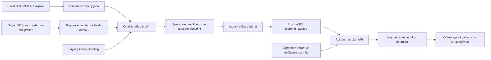

# Sistem rehberi — Sistemin omurgası

[Rehber dizini](../00_SISTEM_REHBERI.md) · Ne zaman okunur: Uygulamanın katmanları ve veri akışı; ilk kez sistemi tanırken.

## Sistemin omurgası

Tek uygulama `D:\workspace\ivme\uygulama` altındadır: React/Vite ön yüz,
Spring Boot API ve PostgreSQL. Özgün eğitim dosyaları üst dizindeki `Kaynaklar`,
çıkarım girdileri `veri-hatti`, korunmuş soru kartları `icerik/data` altındadır.
Uygulamanın `veri/` dizini büyük üretim çıktıları, önbellekler ve denetim kanıtlarını tutar.
Özgün içerik, üretilmiş katalog, öğretmen kararı ve öğrenci olayı birbirinden ayrıdır.

