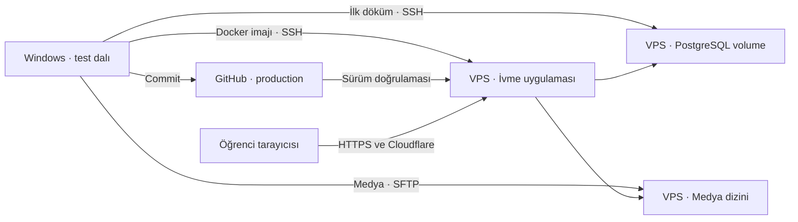

# İvme’yi bilgisayardan VPS’ye taşıma ve güncelleme rehberi

## 1. Hangi sunucuyu alalım?

### 1.1. İvme için başlangıç seçimi

**Yaklaşık 10 kullanıcı, tek İvme sitesi ve ölçülen yaklaşık 60 GB veri için Cloud VPS 4 ile başlardım.** Sipariş ekranında **4 vCPU, 8 GB RAM, 100 GB SSD ve Ubuntu 24.04 LTS (x86_64)** seç. Bu seçimde ikinci tam geri yüklemeyi başka bir makinede yap, yedekleri VPS dışına kopyala ve uygulamanın Java heap sınırını başlangıçta `-Xmx2g` yap. Gerçek veriyi yükledikten sonra disk ve RAM’i ölç. Türkiye ağırlıklı kullanımda Avrupa bölgesini seç. [Contabo VPS özellikleri](https://contabo.com/en-us/pricing/) · [Ubuntu seçenekleri](https://contabo.com/en-us/linux-vps/)

### 1.2. VPS 4, VPS 6 ve VPS 8 ne demek?

**VPS**, bir sağlayıcının fiziksel makinesi üzerinde sana ayrılan sanal sunucudur. Sana kendi işletim sistemi, disk alanı ve IP adresi verilir. **Cloud VPS 8** Contabo’nun paket adı. Bu seride rakam paketteki vCPU sayısıyla örtüşüyor. Aynı tabloda RAM ve disk ayrıca yazıyor. vCPU, sanal işlemci çekirdeği anlamına gelir. Core serisi işlemci kapasitesini fiziksel sunucu üzerindeki diğer VPS’lerle paylaşır. [Contabo VPS dokümantasyonu](https://docs.contabo.com/docs/servers-hosting/vps/)

| Plan | Güncel Core özellikleri | İvme için anlamı |
|---|---|---|
| Cloud VPS 4 | 4 vCPU, 8 GB RAM, 100 GB SSD | Mevcut tek site ve küçük kullanıcı grubu için ölçerek başlanacak plan. |
| Cloud VPS 6 | 6 vCPU, 12 GB RAM, 200 GB SSD veya 100 GB NVMe | Disk payı amacıyla yükseltiyorsan **200 GB SSD** seçilir. İkinci bir proje veya aynı VPS’de geri yükleme provası için daha geniş pay sağlar. |
| Cloud VPS 8 | 8 vCPU, 24 GB RAM, 300 GB SSD veya 150 GB NVMe | Birkaç aktif uygulama, daha yüksek eşzamanlı yük veya büyük yerel depolama ihtiyacı oluşursa değerlendirilir. |

Siparişte görünen CPU, RAM ve disk kapasitesini kontrol et. Paket adları, seçenekler ve fiyatlar değişebilir. [Contabo Core plan tablosu](https://contabo.com/en-us/pricing/)

Sipariş ekranındaki **Image**, Contabo’nun başlangıçta kuracağı işletim sistemidir. Ubuntu’nun dahil olan seçeneğini ve tek IPv4 adresini seç. İvme için ilave özel ağ, ücretli panel, sağlayıcı nesne depolaması veya ücretli izleme gerekmez. Yedek için VPS dışında erişebildiğin bir depolama alanı ayır. [Sipariş seçenekleri](tek-tikla-yayin.md#contabo-siparişi)

### 1.3. 100 GB nasıl yeter?

Yerel ölçümü aynı birimde toplayınca aşağıdaki tablo çıkıyor. Sağlayıcı 100 **GB** ondalık kapasite veriyorsa Linux bunu yaklaşık **93 GiB** olarak gösterir. Biçimlendirme ve sistemin ayırdığı alan kullanılabilir kapasiteyi biraz düşürebilir.

| Kalem | İvme için yaklaşık boyut |
|---|---:|
| Açılmış PostgreSQL veritabanı ve indeksleri | 38,45 GiB |
| Çalışma medyası, soru görselleri, gereken PDF’ler ve kataloglar | 15,73 GiB |
| Bir sıkıştırılmış PostgreSQL prova dökümü | 2,73 GiB, yani 2,93 GB |
| Canlı veri, medya ve bir döküm toplamı | Yaklaşık 57 GiB, yani 61 GB |
| Ubuntu, Docker çalışma dosyaları, imajlar ve günlükler için örnek bütçe | 8–15 GiB |
| 100 GB diskte büyüme ve işlemler için tahmini kalan | 21–28 GiB, dosya sistemi payı düşülmeden |

Disk bütçesinin son iki satırı tahmindir. İlk geri yüklemede PostgreSQL indeksleri oluşturur ve geçici yazma alanı kullanır. Sıkıştırılmış 2,93 GB döküm açıldığında veritabanı ve indeksler için ayrıca disk alanı gerekir. İlk kurulumdan sonra `df -h /srv/ivme` ile gerçek boş alanı ölç. [PostgreSQL döküm biçimleri](https://www.postgresql.org/docs/18/app-pgdump.html) · [PostgreSQL işlem günlüğü ve disk](https://www.postgresql.org/docs/18/wal-internals.html)

#### 1.3.1. İvme veritabanı neden 38,45 GiB?

Yerel `ivme` veritabanında ölçülen **alanın %94,7’si iki katalog tablosunda.** İvme, soru ve kaynakların otomatik etiketlerini, kanıtlarını ve ders–konu bağlantılarını katalog sürümleriyle saklıyor.

| Tablo | Ne tutuyor? | Tüm sürümlerde satır | Güncel sürümde satır | Diskte |
|---|---|---:|---:|---:|
| `learning_catalog.items` | Sorular, PDF’ler ve diğer kaynaklar için etiket, kaynak kanıtı ve katalog ayrıntıları | 8.430.694 | 100.822 | 29,46 GiB |
| `learning_catalog.assignments` | Her katalog öğesinin ders ve konularla bağlantıları | 12.424.111 | 141.132 | 6,95 GiB |
| `public.questions` | Esas soru bankası | 97.061 | — | 35 MiB |

Veritabanında **90 katalog çalıştırması** kayıtlı. Bir soru her yeni katalog sürümünde tekrar temsil edilebiliyor. Uygulamanın güncel katalog sorguları tek etkin sürümü seçiyor. Örneğin bir sorunun katalog kaydı ve konu bağlantısı, sonraki yayında korunurken önceki sürümdeki kayıt da veritabanında kalıyor. Bu yüzden yaklaşık 97 bin soruya karşılık milyonlarca katalog satırı oluşmuş. Hesap ve öğrenci geçmişinin de bulunduğu `public` şemasının tamamı yaklaşık **49 MiB**. [Katalog tabloları ve güncel sürüm görünümleri](../../backend/src/main/resources/db/migration/V38__shared_learning_resource_labels.sql) · [Sürüm kopyalayan göç örneği](../../backend/src/main/resources/db/migration/V102__mebi_main_question_bank.sql)

`items` tablosundaki **23,11 GiB**, PostgreSQL’in büyük alanları ayrı sakladığı TOAST bölümünde. Bu tablo kaynak ve etiket ayrıntılarını JSON olarak saklıyor. `assignments` tablosunda **5,28 GiB** sorguları hızlandıran indekslere ait. Soru görselleri ve özgün PDF dosyaları üstteki **15,73 GiB medya** kaleminde ayrıca sayılıyor. PDF dosyalarını azaltmak medya alanını düşürür. Veritabanındaki tarihsel katalog satırlarının alanı ayrı bir konudur. [PostgreSQL’in büyük alanları saklama biçimi](https://www.postgresql.org/docs/18/storage-toast.html)

### 1.4. 100 GB hangi durumda dar gelir?

Canlı yaklaşık 38 GiB veritabanı çalışırken aynı diske ikinci tam kopyayı açarsan, örnek toplam yaklaşık **103–110 GiB** olur. Bu toplam, 100 GB diskin yaklaşık 93 GiB kapasitesini aşar. Biriken yedekler, başka projeler veya yerel arşivin tamamı da alanı doldurabilir. İlk kurulumda ise hedef veritabanı boş olduğu için tek kopya açılır.

100 GB ile kalmak için şu düzeni kullan:

1. Uygulama paketini Windows’ta derle, VPS’de çalışan imajı ve geri dönüş için gereken son sağlıklı imajı sakla.
2. Ham OCR çıktıları, üretim hattı önbellekleri ve kaynak arşivi yerelde dursun. VPS’ye öğrencinin ve uygulamanın kullandığı medya gitsin.
3. Sıkıştırılmış dökümleri şifreli olarak VPS dışına kopyala. Sunucuda tutacağın kopya sayısını ve alanı düzenli kontrol et.
4. İkinci tam geri yüklemeyi yeterli alanı olan ayrı bir makine veya hacimde prova et.
5. Örneğin **20 GiB boş alanı** inceleme eşiği olarak kullan. Bu eşik bir işletim tercihi. Yeni bir büyük göçten önce işin gerektireceği alanı ayrıca kontrol et.

**Önceki 300 GB önerisi**, gelecekteki projeleri ve geri yükleme kopyalarını aynı diskte tutmak için geniş pay bırakıyordu. Mevcut İvme verisi için VPS 4 daha orantılı. İkinci proje veya ikinci veritabanı kopyası somutlaştığında 200 GB SSD seçeneğini yeniden değerlendir.

### 1.5. 8 GB RAM neden makul?

RAM diskteki 60 GB ile aynı şey değildir. Java uygulaması çalışırken bellekte tuttuğu veriler için RAM kullanır. PostgreSQL diskten sorgular, sık kullanılan verileri bellekte önbelleğe alır. PDF’ler ve soru görselleri ihtiyaç oldukça diskten okunur. Kullanıcı sayısının yanında eşzamanlı istek sayısı, sorgu yükü ve aynı anda çalışan işler önemlidir.

On kullanıcılı başlangıçta Ubuntu, Spring Boot ve PostgreSQL’i **8 GB RAM** üzerinde denemek makul. İvme’nin hazır sunucu ayarı `-Xmx4g` ile geliyor. 8 GB planda ilk açılıştan önce sunucudaki `/srv/ivme/config/compose.env` dosyasında `IVME_JAVA_OPTS=-Xmx2g` kullan. Bu yalnız Java heap üst sınırı. JVM’in diğer bellek kullanımı, PostgreSQL ve Ubuntu ayrıca yer ister. OCR ve toplu içerik üretimini yerelde çalıştır. Bu boyutlandırma bir başlangıç önerisi. Tam veri ve canlı trafik altında `free -h`, `docker stats --no-stream` ve sayfa yanıt süreleriyle doğrula. [Compose yapılandırması](../../deploy/compose.yaml)

## 2. Hangi parça ne işe yarıyor?

### 2.1. Yerel bilgisayar, GitHub ve sunucu

| Parça | Görevi | İçinde ne var? |
|---|---|---|
| Windows ve yerel `test` dalı | Geliştirme, tarayıcı denemesi, sürüm hazırlama | React ve Java kodu, yerel `ivme_local` veritabanı, çalışma dosyaları. |
| Git ve GitHub `production` dalı | Kod geçmişini ve yayımlanacak sürümü kaydetme | Kod, Flyway SQL dosyaları, dağıtım betikleri. Bir commit’in SHA’sı o sürümün kimliği. |
| Docker Desktop | Windows’ta Linux uygulama imajını derleme ve test etme | React derlemesiyle birlikte Spring Boot uygulamasını çalıştıracak imaj. |
| Ubuntu VPS ve Docker Engine | Uygulamayı sürekli çalıştırma | İvme uygulama konteyneri, PostgreSQL konteyneri, kalıcı disk ve medya dizini. |
| Docker Compose | Uygulama, veritabanı, ağ, disk ve başlatma kurallarını birlikte tanımlama | `deploy/compose.yaml` ile `app`, `db` ve gerektiğinde `migrate`. |
| PostgreSQL 18 ve pgvector | Verileri saklama ve sorgulama | Kullanıcılar, cevaplar, soru bankası, içerik katalogları ve uzantı. |
| Flyway | Veritabanı yapısını sürümlü SQL adımlarıyla değiştirme | Örneğin V104. Uygulanan göç geçmişi PostgreSQL’de saklanır. |
| OpenSSH ve rclone | İmaj, döküm ve medyayı özel bağlantıyla aktarma | SSH komut ve imaj taşıma, rclone ise SFTP ile değişen medya dosyalarını taşıma. |
| Cloudflare Tunnel | Ziyaretçiyi HTTPS üzerinden uygulamaya ulaştırma | `net.ivme.dev` yönlendirmesi, VPS’deki `127.0.0.1:1010` uygulama adresi. |

GitHub deposu herkese açık. Gerçek öğrenci verileri, veritabanı parolaları, özel anahtarlar, dökümler ve çalışma medyası özel SSH/SFTP aktarımında tutulur. [Tek tıkla dağıtım komutları](tek-tikla-yayin.md) · [Cloudflare Tunnel yönlendirmesi](https://developers.cloudflare.com/tunnel/concepts/routing/)

### 2.2. Bir Docker imajı ile bir konteynerin farkı

İmaj, çalıştırılabilir uygulama paketidir. Konteyner, o paketin çalışan örneğidir. Dağıtım betiği yerelde React ön yüzünü derler, Java uygulamasını paketler ve sonucu `ivme-app:<commit-sha>` diye etiketler. V104 prova imajı SSH aktarımı için yaklaşık **220 MB** ölçüldü. Medya ve veritabanı bunun dışında kalıcı diskte durur. Yeni uygulama imajı açıldığında aynı veritabanı volume’u kullanılır. Volume, PostgreSQL dosyalarının konteyner değişse bile korunduğu Docker disk alanıdır. [Dockerfile](../../Dockerfile) · [Compose yapılandırması](../../deploy/compose.yaml)



## 3. İlk taşıma nasıl yapılır?

### 3.1. Yerelde yayımlanacak sürümü belirle

1. `D:\workspace\ivme\uygulama` içinde `test` dalına bak. `git status --short --branch` ile değişiklikleri gör. IDE’nin Git bölümünde yayıma girecek dosyaları seçip **stage** et. Stage, dosyayı bir sonraki commit’e seçmektir. Taslaklar yerelde kalır.
2. Hangi Flyway sürümünün kaynak veritabanında uygulandığını doğrula. Hazırlanan prova dökümü **V104**. GitHub’daki mevcut üretim temeli **V102**. V104 dökümünü açacak ilk sürüm, V103 ve V104 göçlerini ve bunlarla uyumlu uygulama kodunu içermeli. Yerel V104 imajı Linux’ta prova edildi. Canlı yayın seçimi ayrıca hazırlanır.
3. Yayına girecek değişiklikleri commit ettikten sonra üretim Docker derlemesini yerelde prova edebilirsin. `python -X utf8 deploy/release.py --preview` mevcut commit’i kullanır ve GitHub’a push yapmadan Linux imajı ve testleri çalıştırır. Stage’deki değişiklikleri incelemek için önce commit gerekir. [Tek tıkla yayın tarifi](tek-tikla-yayin.md)

### 3.2. VPS’ye erişimi ve işletim ortamını kur

1. Contabo’dan Ubuntu 24.04 LTS imajıyla VPS aç. Siparişte Windows’taki `%USERPROFILE%\.ssh\ivme-vps.pub` açık anahtarını ekle. İlk bağlantıda sunucunun SSH parmak izini sağlayıcı konsolundan doğrula. Bunun amacı doğru makineye bağlandığını kontrol etmektir.
2. VPS’de dağıtım hesabını ve Windows’ta `ivme-vps` SSH takma adını oluştur. `ssh ivme-vps` bağlantısını dene. Yerelde `deploy/local.json` bu takma adı kullanır. Böylece betikler ve medya aktarımı aynı bağlantı ayarını paylaşır.
3. Sunucuda `deploy/bootstrap-ubuntu.sh` betiğini ayrıntılı tarifteki yönetici adımıyla çalıştır. Betik Docker Engine, Compose ve Git’i kurar. `/srv/ivme/config`, `data`, `releases` ve `backup` dizinlerini hazırlar. Uygulama ile veritabanı yönetimi için ayrı parolalar oluşturur. 8 GB plan aldıysan burada 1.5’teki Java ayarını uygula. [Adım adım SSH ve bootstrap komutları](tek-tikla-yayin.md#sunucunun-ilk-kurulumu)

### 3.3. Medyayı ve ilk veritabanını taşı

1. `deploy/assets.py` ile VPS’nin ihtiyacı olan dosyaların listesini hazırla veya doğrulanmış yerel medya manifestini kullan. Manifest, hangi dosyanın taşınacağını, SHA-256 değerini ve Linux’ta hangi PDF yolunun kullanılacağını yazar. `Ivme Medya Gonder.bat` ile dosyaları gönder. VPS dosyaların hash’lerini kontrol eder ve katalog yol listesini en son etkinleştirir.
2. Canlı geçiş anında eski uygulamadaki yeni yazıları durdur ve kaynak PostgreSQL’den son `pg_dump -Fc` dökümünü al. Döküm başlangıç anının tutarlı kopyasıdır. Yazılar sürerse daha sonra gelen öğrenci cevapları bu kopyanın dışında kalır. Dökümün yanına `.sha256` dosyasını koy. [PostgreSQL pg_dump](https://www.postgresql.org/docs/18/app-pgdump.html)
3. Yerel uygulama dizininde `python -X utf8 deploy/release.py --restore "D:\private\ivme.dump"` çalıştır. Örnek yolu gerçek dosyayla değiştir. Betik dökümün hash’ini ve Flyway geçmişiyle kodun uyumunu denetler. İmajı ve dökümü özel SSH bağlantısından gönderir. Sunucuda boş PostgreSQL’e `pg_restore` ile geri yükler ve uygulamayı açar. Bu işlem **ilk taşıma** içindir. [İlk taşıma tarifi](vps-yayini.md) · [PostgreSQL pg_restore](https://www.postgresql.org/docs/18/app-pgrestore.html)

Windows’ta `D:\private` yerine erişimi kısıtlı kendi çıktı dizinini kullan. İlk komut yeni bir medya manifesti üretir. Sonraki komutlar kaynak veritabanı kullanıcısını ve parolasını yerelde sorar, dökümü oluşturur, okunabildiğini kontrol eder ve hash dosyasını yazar.

```powershell
python -X utf8 deploy/assets.py "D:\workspace\ivme" "D:\private\ivme-media"
$ivmePgBin = 'C:\Program Files\PostgreSQL\18\bin'
$ivmeDump = 'D:\private\ivme.dump'
$ivmeDbUser = Read-Host 'Kaynak PostgreSQL kullanıcı adı'
& "$ivmePgBin\pg_dump.exe" -h 127.0.0.1 -p 5432 -U $ivmeDbUser -W -d ivme -Fc -f $ivmeDump
if ($LASTEXITCODE -ne 0) { throw 'Döküm oluşturulamadı.' }
& "$ivmePgBin\pg_restore.exe" --list $ivmeDump | Out-Null
if ($LASTEXITCODE -ne 0) { throw 'Döküm okunamadı.' }
$ivmeSha = (Get-FileHash -Algorithm SHA256 -LiteralPath $ivmeDump).Hash.ToLowerInvariant()
"$ivmeSha  ivme.dump" | Set-Content -LiteralPath "$ivmeDump.sha256" -Encoding ascii
```

### 3.4. Kullanıcıları yeni sunucuya geçir

1. VPS’de uygulamanın hazır olduğunu kontrol et. Giriş, soru görseli, canlı PDF bağlantısı ve mevcut bir hesabın geçmişini dene. `app-version.txt` değerini beklenen commit SHA’sıyla karşılaştır.
2. Cloudflare’da `net.ivme.dev` adresini yeni Ubuntu sunucusundaki tünele yönlendir. Tünelin yerel hedefi `http://127.0.0.1:1010`. Kullanıcı adresi HTTPS olarak açar. PostgreSQL, Compose’un iç ağında kalır.
3. Tarayıcıdan dış adresi doğrula. Bu noktadan sonra gerçek öğrenci yazılarının ana kaynağı VPS’deki `ivme` olur. Yerel `ivme_local` geliştirme içindir. [Cloudflare Tunnel kurulumu](https://developers.cloudflare.com/tunnel/get-started/)

## 4. Sonraki güncelleme nasıl yapılacak?

### 4.1. Uygulama kodu değiştiğinde

1. Yerel `test` dalında çalış ve `localhost:1012` üzerinden dene. IDE’de yalnız yayıma girecek değişiklikleri stage et.
2. **Ivme Yayinla.bat** dosyasına çift tıkla. Seçilen dosyalar commit edilir. Hazır commit varsa araç o SHA’yı kullanır. Yerel `test` ile GitHub `production` arasında çakışma varsa araç durur, çakışmayı çözmek gerekir.
3. Araç Linux imajını derler ve yayına ait testleri çalıştırır. İmajı SSH ile VPS’ye iletir ve aynı kod sürümünü GitHub `production` dalına push eder. VPS doğru SHA ile konteyneri başlatır.
4. VPS hem sağlık kontrolünü hem `app-version.txt` değerini denetler. Başlatma başarısızsa ve şema uyumluysa önceki sağlıklı uygulama sürümü denenir. GitHub’daki son commit ile VPS’de çalışan SHA bu durumda farklı olabilir.

Otomasyon **düğmeye basınca** başlar. Her yerel kaydetme, VPS’ye kendi başına yayın başlatmaz. Günlük yayında medya veya yeni veritabanı dökümü taşıman gerekmez. [Yayın betiği](../../deploy/release.py) · [VPS yayın ve geri dönüş betiği](../../deploy/vps.sh)

### 4.2. Veritabanı yapısı değiştiğinde

Bir alan, tablo veya indeks ekleniyorsa değişiklik yeni bir Flyway SQL dosyasıyla koda girer. Önce yerelde test edilir. Yayında sunucu yeni göçleri tespit eder, uygulamayı durdurur, sıkıştırılmış PostgreSQL yedeği alır ve göçü VPS’deki mevcut veriye uygular. Ardından uygulamayı açar. Böylece sunucudaki cevaplar ve hesaplar aynı veritabanında kalır. Şema değişiminden sonra eski imajın çalışması uyuma bağlıdır. Şema veya veri geri dönüşü gerektiğinde eldeki yedek ve yeni öğrenci kayıtları birlikte değerlendirilir. [VPS göç adımları](../../deploy/vps.sh)

### 4.3. Yeni soru, görsel veya PDF eklenirse

Sorunun metni, doğru cevabı ve katalog kaydı **veritabanı içeriğidir**. Görsel ve PDF ise **dosyadır**. Örneğin yeni bir soru yayınlarken önce referans verilen görseli medya aktarımıyla gönder ve doğrula, sonra onaylı soru kaydını mevcut içerik aktarım yoluyla VPS veritabanına ekle. Yerel veritabanını yeniden yüklemek, o arada canlıda oluşmuş öğrenci kayıtlarını kaybettirebilir. Yeni PDF kataloğu uygulama açılışında yükleniyorsa medya aktarımından sonra uygulamayı kontrollü yeniden başlat. [Soru aktarım tarifi](soru-aktarma.md) · [Medya aktarımı](tek-tikla-yayin.md#medya-cloudflare-ve-sonraki-projeler)

### 4.4. Orijinal PDF’leri azalttığında

Bir sorunun kırpılmış görseli ve cevabı bankada bulunuyorsa bu soru için özgün PDF’nin öğrenciye sunulması gerekmeyebilir. Konu anlatımı veya kitapçık bağlantısı hâlâ PDF’yi açıyorsa ilgili dosyayı canlı kapsamda tut. Önce kaynak kurallarına göre dosyanın neden ayrılabileceğini listele, ilgili bağlantıları doğrula ve yedeği al. Yayımdan kaldırma kaydı işlendikten sonra yeni medya manifestinde o PDF’nin hash’ini hariç tutabilirsin. Medya aktarımı mevcut dosyaları kopyalar. Diskte yer açmak için eski kopyaların temizliği, doğrulanmış listeden ayrı yapılır. [İvme kaynak saklama kuralları](../plan/16-ogrenme-kalitesi.md#silme-kuralları)

## 5. Kurulumdan sonra neyi izlemeliyim?

### 5.1. Disk, bellek ve yedek

1. `df -h /srv/ivme` ile toplam boş alanı, `docker system df` ile Docker’ın disk kullanımını kontrol et. Bir sonraki göç veya geri yükleme için alanı önceden hesapla.
2. `free -h` ve `docker stats --no-stream` ile birden çok kullanıcı aynı anda çalışırken RAM’i gözle. Bellek baskısı, sürekli swap kullanımı veya yavaşlayan sorgu görürsen önce ölçümleri ve Java ayarını incele.
3. Bir göçten önce dağıtım aracı yerel sunucu yedeği alır. Öğrenciler günlük yazdığı için düzenli yedekleri ayrıca planla, VPS dışına şifreli kopyala ve geri yükleme provası yap. Yedek alındı mesajı, geri yükleme provasının yerini tutmaz. [PostgreSQL yedekleme tarifi](https://www.postgresql.org/docs/18/backup-dump.html)

### 5.2. Başka projeleri ekleme

Her proje için ayrı Compose adı, `/srv/<proje>` dizini, veritabanı veya volume, parola dosyası ve loopback portu kullan. İvme 1010’da, sonraki proje örneğin 1020’de çalışabilir. Cloudflare aynı tünelden her alt alan adını ilgili porta yönlendirebilir. Yeni proje eklerken kendi disk ve RAM ihtiyacını ölç. Aynı anda yoğun çalışan birden fazla proje olduğunda VPS 6 veya VPS 8’i tekrar değerlendir. [Cloudflare çoklu uygulama yönlendirmesi](https://developers.cloudflare.com/tunnel/concepts/routing/)

### 5.3. İlk yayın sonunda doğrulanacaklar

1. Canlı adres açılıyor ve beklenen SHA’yı gösteriyor.
2. Var olan bir kullanıcı giriş yapabiliyor, geçmişini ve güncel bir sorunun görselini görebiliyor.
3. Canlıda sunulması gereken bir PDF açılıyor.
4. VPS gerçek veriyle açıldıktan sonra boş disk ve RAM ölçüldü.
5. Çalışan sürüm, son yedek ve yedeğin VPS dışındaki konumu kayıtlı.
